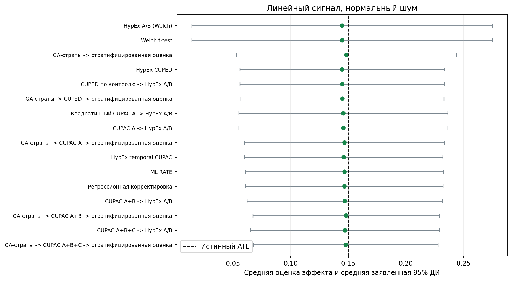
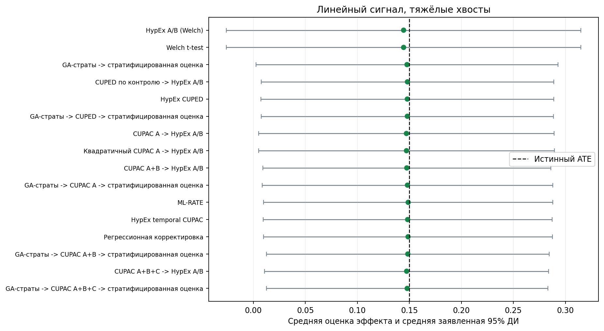
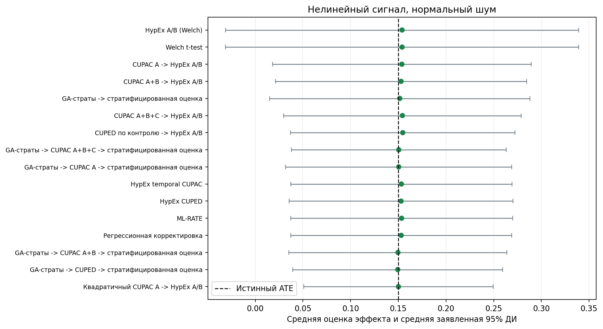
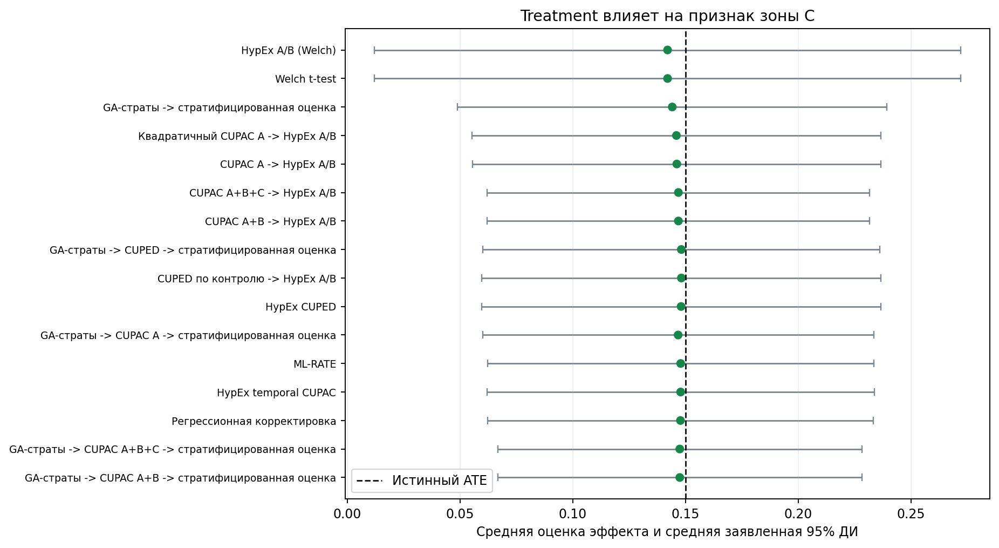
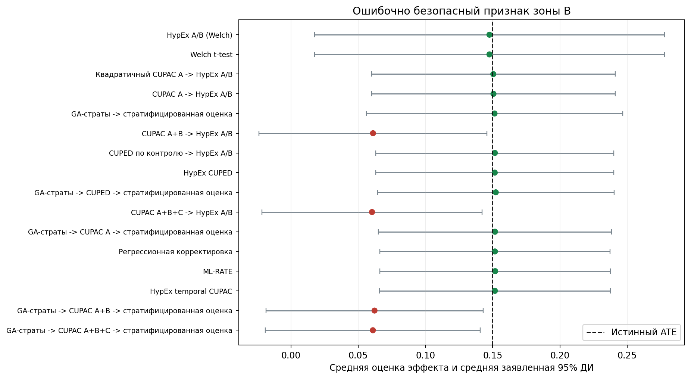

# Гонка аналитических пайплайнов VarWar v2

## Короткий вывод

Сравниваются полные аналитические пайплайны, а не изолированные примитивы. Сначала проверяются смещение, FPR и покрытие; только после этого рассматриваются дисперсия, мощность и стоимость.

- **Линейный сигнал, нормальный шум.** Минимальное наблюдаемое SD среди прошедших допуск: **GA-страты -> CUPAC A+B+C -> стратифицированная оценка**; снижение дисперсии относительно Welch: **62.7%**, мощность: **93.5%**. Это численное ранжирование, а не доказательство превосходства над близкими кандидатами.
- **Линейный сигнал, тяжёлые хвосты.** Минимальное наблюдаемое SD среди прошедших допуск: **GA-страты -> CUPAC A+B+C -> стратифицированная оценка**; снижение дисперсии относительно Welch: **32.0%**, мощность: **60.0%**. Это численное ранжирование, а не доказательство превосходства над близкими кандидатами.
- **Нелинейный сигнал, нормальный шум.** Минимальное наблюдаемое SD среди прошедших допуск: **Квадратичный CUPAC A -> HypEx A/B**; снижение дисперсии относительно Welch: **75.4%**, мощность: **89.0%**. Это численное ранжирование, а не доказательство превосходства над близкими кандидатами.
- **Treatment влияет на признак зоны C.** Минимальное наблюдаемое SD среди прошедших допуск: **GA-страты -> CUPAC A+B -> стратифицированная оценка**; снижение дисперсии относительно Welch: **56.0%**, мощность: **93.0%**. Это численное ранжирование, а не доказательство превосходства над близкими кандидатами.
- **Ошибочно безопасный признак зоны B.** Минимальное наблюдаемое SD среди прошедших допуск: **ML-RATE**; снижение дисперсии относительно Welch: **63.1%**, мощность: **95.0%**. Это численное ранжирование, а не доказательство превосходства над близкими кандидатами.

## Постановка

- Monte Carlo повторов на H0 и H1: `200`.
- Строк в одном эксперименте: `2500`.
- Истинный средний эффект H1: `0.15`.
- Уровень значимости: `0.05`.
- H0 и H1 внутри повтора имеют одинаковые признаки, assignment и шум; отличается только добавленный treatment effect.
- Отдельной обучающей выборки нет: модель CUPAC A использует `lag2 -> lag1`, локальные CUPED/B/C оценивают коэффициенты по текущему контролю, а GA использует только pre-target тех же строк. Интеграционные HypEx CUPED/CUPAC сохраняют политику пакета и оценивают theta на всём текущем эксперименте.
- A — предэкспериментные признаки; B — экспертно безопасные признаки текущего периода и отдельная линейная корректировка; C — ещё одна линейная корректировка после смыслового отсева и проверок баланса, пропусков и распределения.
- Balance gate не доказывает причинную безопасность. Сценарий `misclassified_b` намеренно проверяет цену экспертной ошибки.

## Правило допуска

Для первичного R&D-экрана заранее заданы практические допуски: |bias| ≤ 0,02, FPR ≤ 8%, покрытие ≥ 92% и SE/SD от 0,80 до 1,20. Также требуются 100% успешных запусков.
Прохождение экрана не доказывает статистическую валидность и не является результатом множественной проверки. Точные биномиальные интервалы FPR и power приведены для оценки неопределённости Monte Carlo.
Винзоризация вынесена в отдельный estimand и не участвует в рейтинге исходного ATE.

## Каталог гонки

| pipeline | pipeline_name_ru | components | estimand | pipeline_tier | predecessor_pipeline |
| --- | --- | --- | --- | --- | --- |
| welch | Welch t-test | welch_mean_diff | ATE | confirmatory |  |
| hypex_ab | HypEx A/B (Welch) | hypex_ab | ATE | integration_parity | welch |
| hypex_cuped | HypEx CUPED | hypex_cuped -> hypex_ab | ATE | integration_parity | hypex_ab |
| cuped_control__hypex_ab | CUPED по контролю -> HypEx A/B | cuped_control -> hypex_ab | ATE | confirmatory | hypex_ab |
| hypex_cupac_temporal | HypEx temporal CUPAC | hypex_cupac_temporal -> hypex_ab | ATE | integration_parity | hypex_ab |
| cupac_linear_A__hypex_ab | CUPAC A -> HypEx A/B | cupac_linear_A -> hypex_ab | ATE | confirmatory | hypex_ab |
| cupac_linear_A_plus_B__hypex_ab | CUPAC A+B -> HypEx A/B | cupac_linear_A_plus_B -> hypex_ab | ATE | exploratory | cupac_linear_A__hypex_ab |
| cupac_linear_A_plus_B_plus_C__hypex_ab | CUPAC A+B+C -> HypEx A/B | cupac_linear_A_plus_B_plus_C -> hypex_ab | ATE | exploratory | cupac_linear_A_plus_B__hypex_ab |
| cupac_quadratic_A__hypex_ab | Квадратичный CUPAC A -> HypEx A/B | cupac_quadratic_A -> hypex_ab | ATE | exploratory | cupac_linear_A__hypex_ab |
| regression_adjustment | Регрессионная корректировка | regression_adjustment | ATE | confirmatory | welch |
| ml_rate | ML-RATE | ml_rate | ATE | exploratory | welch |
| winsorized__hypex_ab | Винзоризация -> HypEx A/B | winsorized -> hypex_ab | ATE винзоризированного target | changed_metric |  |
| ga_strata__stratified | GA-страты -> стратифицированная оценка | genetic_strata_reducer -> stratified_mean_diff | ATE с фиксированными pre-period весами страт | confirmatory | welch |
| ga_strata__cuped_control__stratified | GA-страты -> CUPED -> стратифицированная оценка | genetic_strata_reducer -> cuped_control -> stratified_mean_diff | ATE с фиксированными pre-period весами страт | confirmatory | ga_strata__stratified |
| ga_strata__cupac_linear_A__stratified | GA-страты -> CUPAC A -> стратифицированная оценка | genetic_strata_reducer -> cupac_linear_A -> stratified_mean_diff | ATE с фиксированными pre-period весами страт | confirmatory | ga_strata__stratified |
| ga_strata__cupac_linear_A_plus_B__stratified | GA-страты -> CUPAC A+B -> стратифицированная оценка | genetic_strata_reducer -> cupac_linear_A_plus_B -> stratified_mean_diff | ATE с фиксированными pre-period весами страт | exploratory | ga_strata__cupac_linear_A__stratified |
| ga_strata__cupac_linear_A_plus_B_plus_C__stratified | GA-страты -> CUPAC A+B+C -> стратифицированная оценка | genetic_strata_reducer -> cupac_linear_A_plus_B_plus_C -> stratified_mean_diff | ATE с фиксированными pre-period весами страт | exploratory | ga_strata__cupac_linear_A_plus_B__stratified |

## Линейный сигнал, нормальный шум

Благоприятный базовый сценарий.

Минимальное наблюдаемое SD среди прошедших допуск: **GA-страты -> CUPAC A+B+C -> стратифицированная оценка**; снижение дисперсии относительно Welch: **62.7%**, мощность: **93.5%**. Это численное ранжирование, а не доказательство превосходства над близкими кандидатами.

### Цепочка A/B/C

| Пайплайн | Контур | Диагностический статус | Bias | SD | SE/SD | VR к Welch, % | Инкремент, % | FPR, % | Power, % | Coverage, % | Время, мс |
| --- | --- | --- | --- | --- | --- | --- | --- | --- | --- | --- | --- |
| CUPAC A+B+C -> HypEx A/B | exploratory | прошёл диагностический допуск | -0.0028 | 0.0429 | 0.974 | 60.8 | 10.1 | 5.5 | 92.5 | 94.5 | 33.6 |
| CUPAC A+B -> HypEx A/B | exploratory | прошёл диагностический допуск | -0.0029 | 0.0453 | 0.957 | 56.4 | 16.4 | 5.0 | 91.5 | 95.0 | 31.77 |
| HypEx temporal CUPAC | integration_parity | прошёл диагностический допуск | -0.0039 | 0.0473 | 0.927 | 52.3 | 52.3 | 7.5 | 90.5 | 92.5 | 100.7 |
| CUPAC A -> HypEx A/B | confirmatory | прошёл диагностический допуск | -0.0042 | 0.0495 | 0.934 | 47.8 | 47.8 | 6.5 | 86.5 | 93.5 | 30.65 |
| HypEx A/B (Welch) | integration_parity | прошёл диагностический допуск | -0.0053 | 0.0685 | 0.971 | 0.0 | 0.0 | 5.0 | 60.0 | 95.0 | 29.78 |

### Все пайплайны

| Пайплайн | Контур | Диагностический статус | Bias | SD | SE/SD | VR к Welch, % | Инкремент, % | FPR, % | Power, % | Coverage, % | Время, мс |
| --- | --- | --- | --- | --- | --- | --- | --- | --- | --- | --- | --- |
| GA-страты -> CUPAC A+B+C -> стратифицированная оценка | exploratory | прошёл диагностический допуск | -0.0021 | 0.0419 | 0.976 | 62.7 | 5.1 | 4.5 | 93.5 | 95.5 | 45.0 |
| CUPAC A+B+C -> HypEx A/B | exploratory | прошёл диагностический допуск | -0.0028 | 0.0429 | 0.974 | 60.8 | 10.1 | 5.5 | 92.5 | 94.5 | 33.6 |
| GA-страты -> CUPAC A+B -> стратифицированная оценка | exploratory | прошёл диагностический допуск | -0.0019 | 0.043 | 0.961 | 60.7 | 17.8 | 5.0 | 94.0 | 95.0 | 43.45 |
| CUPAC A+B -> HypEx A/B | exploratory | прошёл диагностический допуск | -0.0029 | 0.0453 | 0.957 | 56.4 | 16.4 | 5.0 | 91.5 | 95.0 | 31.77 |
| Регрессионная корректировка | confirmatory | прошёл диагностический допуск | -0.0033 | 0.0466 | 0.938 | 53.7 | 53.7 | 6.5 | 91.0 | 93.5 | 1.21 |
| ML-RATE | exploratory | прошёл диагностический допуск | -0.0032 | 0.0467 | 0.937 | 53.5 | 53.5 | 6.5 | 91.0 | 93.5 | 1.83 |
| HypEx temporal CUPAC | integration_parity | прошёл диагностический допуск | -0.0039 | 0.0473 | 0.927 | 52.3 | 52.3 | 7.5 | 90.5 | 92.5 | 100.7 |
| GA-страты -> CUPAC A -> стратифицированная оценка | confirmatory | прошёл диагностический допуск | -0.0032 | 0.0474 | 0.935 | 52.1 | 13.3 | 6.5 | 90.0 | 93.5 | 41.97 |
| CUPAC A -> HypEx A/B | confirmatory | прошёл диагностический допуск | -0.0042 | 0.0495 | 0.934 | 47.8 | 47.8 | 6.5 | 86.5 | 93.5 | 30.65 |
| Квадратичный CUPAC A -> HypEx A/B | exploratory | прошёл диагностический допуск | -0.0042 | 0.0495 | 0.934 | 47.8 | -0.1 | 7.0 | 87.0 | 93.0 | 31.48 |
| GA-страты -> CUPED -> стратифицированная оценка | confirmatory | прошёл диагностический допуск | -0.005 | 0.0497 | 0.905 | 47.4 | 4.8 | 7.5 | 88.0 | 92.5 | 41.5 |
| CUPED по контролю -> HypEx A/B | confirmatory | прошёл диагностический допуск | -0.0052 | 0.05 | 0.905 | 46.8 | 46.8 | 7.5 | 88.0 | 92.5 | 30.28 |
| HypEx CUPED | integration_parity | прошёл диагностический допуск | -0.0053 | 0.0501 | 0.903 | 46.6 | 46.6 | 7.5 | 88.0 | 92.5 | 58.9 |
| GA-страты -> стратифицированная оценка | confirmatory | прошёл диагностический допуск | -0.0015 | 0.0509 | 0.957 | 44.8 | 44.8 | 5.0 | 83.5 | 95.0 | 40.82 |
| Винзоризация -> HypEx A/B | changed_metric | другой estimand |  | 0.0672 | 0.971 | 3.8 |  | 4.5 | 60.5 |  | 29.95 |
| Welch t-test | confirmatory | прошёл диагностический допуск | -0.0053 | 0.0685 | 0.971 | 0.0 |  | 5.0 | 60.0 | 95.0 | 0.28 |
| HypEx A/B (Welch) | integration_parity | прошёл диагностический допуск | -0.0053 | 0.0685 | 0.971 | 0.0 | 0.0 | 5.0 | 60.0 | 95.0 | 29.78 |

## Линейный сигнал, тяжёлые хвосты

Проверка устойчивости SE и выигрыша по дисперсии.

Минимальное наблюдаемое SD среди прошедших допуск: **GA-страты -> CUPAC A+B+C -> стратифицированная оценка**; снижение дисперсии относительно Welch: **32.0%**, мощность: **60.0%**. Это численное ранжирование, а не доказательство превосходства над близкими кандидатами.

### Цепочка A/B/C

| Пайплайн | Контур | Диагностический статус | Bias | SD | SE/SD | VR к Welch, % | Инкремент, % | FPR, % | Power, % | Coverage, % | Время, мс |
| --- | --- | --- | --- | --- | --- | --- | --- | --- | --- | --- | --- |
| CUPAC A+B+C -> HypEx A/B | exploratory | прошёл диагностический допуск | -0.0026 | 0.0692 | 1.006 | 31.2 | 2.8 | 5.5 | 59.0 | 94.5 | 33.84 |
| HypEx temporal CUPAC | integration_parity | прошёл диагностический допуск | -0.0017 | 0.0697 | 1.019 | 30.3 | 30.3 | 4.0 | 56.0 | 96.0 | 101.62 |
| CUPAC A+B -> HypEx A/B | exploratory | прошёл диагностический допуск | -0.0025 | 0.0702 | 1.006 | 29.2 | 1.6 | 4.5 | 57.0 | 95.5 | 32.02 |
| CUPAC A -> HypEx A/B | confirmatory | прошёл диагностический допуск | -0.0028 | 0.0708 | 1.024 | 28.0 | 28.0 | 5.5 | 53.5 | 94.5 | 30.9 |
| HypEx A/B (Welch) | integration_parity | прошёл диагностический допуск | -0.0056 | 0.0835 | 1.042 | 0.0 | 0.0 | 4.0 | 39.0 | 96.0 | 30.35 |

### Все пайплайны

| Пайплайн | Контур | Диагностический статус | Bias | SD | SE/SD | VR к Welch, % | Инкремент, % | FPR, % | Power, % | Coverage, % | Время, мс |
| --- | --- | --- | --- | --- | --- | --- | --- | --- | --- | --- | --- |
| GA-страты -> CUPAC A+B+C -> стратифицированная оценка | exploratory | прошёл диагностический допуск | -0.0021 | 0.0688 | 1.004 | 32.0 | 1.4 | 6.0 | 60.0 | 94.0 | 46.65 |
| CUPAC A+B+C -> HypEx A/B | exploratory | прошёл диагностический допуск | -0.0026 | 0.0692 | 1.006 | 31.2 | 2.8 | 5.5 | 59.0 | 94.5 | 33.84 |
| GA-страты -> CUPAC A+B -> стратифицированная оценка | exploratory | прошёл диагностический допуск | -0.0015 | 0.0693 | 1.001 | 31.0 | 2.2 | 6.0 | 59.5 | 94.0 | 44.74 |
| Регрессионная корректировка | confirmatory | прошёл диагностический допуск | -0.0013 | 0.0696 | 1.019 | 30.5 | 30.5 | 3.5 | 56.0 | 96.5 | 1.23 |
| HypEx temporal CUPAC | integration_parity | прошёл диагностический допуск | -0.0017 | 0.0697 | 1.019 | 30.3 | 30.3 | 4.0 | 56.0 | 96.0 | 101.62 |
| ML-RATE | exploratory | прошёл диагностический допуск | -0.0012 | 0.0697 | 1.019 | 30.3 | 30.3 | 4.0 | 55.5 | 96.0 | 1.84 |
| GA-страты -> CUPAC A -> стратифицированная оценка | confirmatory | прошёл диагностический допуск | -0.0019 | 0.0701 | 1.017 | 29.5 | 8.4 | 5.0 | 55.5 | 95.0 | 43.59 |
| CUPAC A+B -> HypEx A/B | exploratory | прошёл диагностический допуск | -0.0025 | 0.0702 | 1.006 | 29.2 | 1.6 | 4.5 | 57.0 | 95.5 | 32.02 |
| Квадратичный CUPAC A -> HypEx A/B | exploratory | прошёл диагностический допуск | -0.0028 | 0.0708 | 1.025 | 28.1 | 0.1 | 5.0 | 53.5 | 95.0 | 31.35 |
| CUPAC A -> HypEx A/B | confirmatory | прошёл диагностический допуск | -0.0028 | 0.0708 | 1.024 | 28.0 | 28.0 | 5.5 | 53.5 | 94.5 | 30.9 |
| GA-страты -> CUPED -> стратифицированная оценка | confirmatory | прошёл диагностический допуск | -0.002 | 0.0708 | 1.012 | 28.0 | 6.4 | 4.0 | 56.0 | 96.0 | 42.92 |
| HypEx CUPED | integration_parity | прошёл диагностический допуск | -0.002 | 0.071 | 1.011 | 27.6 | 27.6 | 4.5 | 53.5 | 95.5 | 59.16 |
| CUPED по контролю -> HypEx A/B | confirmatory | прошёл диагностический допуск | -0.0019 | 0.0712 | 1.009 | 27.3 | 27.3 | 4.5 | 54.5 | 95.5 | 30.31 |
| GA-страты -> стратифицированная оценка | confirmatory | прошёл диагностический допуск | -0.0023 | 0.0732 | 1.012 | 23.0 | 23.0 | 4.5 | 53.5 | 95.5 | 42.23 |
| Винзоризация -> HypEx A/B | changed_metric | другой estimand |  | 0.0776 | 1.009 | 13.5 |  | 4.5 | 45.0 |  | 29.9 |
| Welch t-test | confirmatory | прошёл диагностический допуск | -0.0056 | 0.0835 | 1.042 | 0.0 |  | 4.0 | 39.0 | 96.0 | 0.28 |
| HypEx A/B (Welch) | integration_parity | прошёл диагностический допуск | -0.0056 | 0.0835 | 1.042 | 0.0 | 0.0 | 4.0 | 39.0 | 96.0 | 30.35 |

## Нелинейный сигнал, нормальный шум

Проверка линейных и квадратичных корректировок.

Минимальное наблюдаемое SD среди прошедших допуск: **Квадратичный CUPAC A -> HypEx A/B**; снижение дисперсии относительно Welch: **75.4%**, мощность: **89.0%**. Это численное ранжирование, а не доказательство превосходства над близкими кандидатами.

### Цепочка A/B/C

| Пайплайн | Контур | Диагностический статус | Bias | SD | SE/SD | VR к Welch, % | Инкремент, % | FPR, % | Power, % | Coverage, % | Время, мс |
| --- | --- | --- | --- | --- | --- | --- | --- | --- | --- | --- | --- |
| HypEx temporal CUPAC | integration_parity | прошёл диагностический допуск | 0.0032 | 0.0599 | 0.989 | 63.3 | 63.3 | 4.5 | 73.5 | 95.5 | 82.57 |
| CUPAC A+B+C -> HypEx A/B | exploratory | прошёл диагностический допуск | 0.0043 | 0.0666 | 0.955 | 54.6 | 10.3 | 6.0 | 66.0 | 94.5 | 27.69 |
| CUPAC A+B -> HypEx A/B | exploratory | прошёл диагностический допуск | 0.0029 | 0.0703 | 0.956 | 49.4 | 2.7 | 5.5 | 60.5 | 94.5 | 26.15 |
| CUPAC A -> HypEx A/B | confirmatory | прошёл диагностический допуск | 0.0037 | 0.0713 | 0.97 | 48.0 | 48.0 | 5.0 | 59.0 | 95.0 | 25.35 |
| HypEx A/B (Welch) | integration_parity | прошёл диагностический допуск | 0.0039 | 0.0988 | 0.956 | 0.0 | 0.0 | 6.5 | 38.0 | 93.5 | 24.55 |

### Все пайплайны

| Пайплайн | Контур | Диагностический статус | Bias | SD | SE/SD | VR к Welch, % | Инкремент, % | FPR, % | Power, % | Coverage, % | Время, мс |
| --- | --- | --- | --- | --- | --- | --- | --- | --- | --- | --- | --- |
| Квадратичный CUPAC A -> HypEx A/B | exploratory | прошёл диагностический допуск | 0.0001 | 0.049 | 1.032 | 75.4 | 52.6 | 6.0 | 89.0 | 94.0 | 26.58 |
| GA-страты -> CUPED -> стратифицированная оценка | confirmatory | прошёл диагностический допуск | -0.0006 | 0.0571 | 0.984 | 66.6 | 30.4 | 4.0 | 76.0 | 96.0 | 35.31 |
| GA-страты -> CUPAC A+B -> стратифицированная оценка | exploratory | прошёл диагностический допуск | -0.0004 | 0.0595 | 0.979 | 63.7 | 2.7 | 5.0 | 69.0 | 95.0 | 36.81 |
| Регрессионная корректировка | confirmatory | прошёл диагностический допуск | 0.003 | 0.0597 | 0.991 | 63.5 | 63.5 | 5.0 | 73.0 | 95.0 | 1.26 |
| ML-RATE | exploratory | прошёл диагностический допуск | 0.0034 | 0.0598 | 0.992 | 63.4 | 63.4 | 5.0 | 73.0 | 95.0 | 1.96 |
| HypEx CUPED | integration_parity | прошёл диагностический допуск | 0.0029 | 0.0599 | 1.001 | 63.3 | 63.3 | 4.5 | 71.0 | 95.5 | 48.47 |
| HypEx temporal CUPAC | integration_parity | прошёл диагностический допуск | 0.0032 | 0.0599 | 0.989 | 63.3 | 63.3 | 4.5 | 73.5 | 95.5 | 82.57 |
| GA-страты -> CUPAC A -> стратифицированная оценка | confirmatory | прошёл диагностический допуск | 0.0004 | 0.0604 | 1.002 | 62.7 | 22.2 | 4.0 | 70.5 | 96.0 | 35.79 |
| GA-страты -> CUPAC A+B+C -> стратифицированная оценка | exploratory | прошёл диагностический допуск | 0.0004 | 0.0604 | 0.951 | 62.6 | -2.9 | 7.0 | 71.5 | 92.5 | 38.37 |
| CUPED по контролю -> HypEx A/B | confirmatory | прошёл диагностический допуск | 0.0046 | 0.0605 | 0.993 | 62.6 | 62.6 | 5.0 | 72.5 | 95.5 | 24.91 |
| CUPAC A+B+C -> HypEx A/B | exploratory | прошёл диагностический допуск | 0.0043 | 0.0666 | 0.955 | 54.6 | 10.3 | 6.0 | 66.0 | 94.5 | 27.69 |
| GA-страты -> стратифицированная оценка | confirmatory | прошёл диагностический допуск | 0.0015 | 0.0685 | 1.016 | 52.0 | 52.0 | 2.5 | 59.0 | 97.0 | 34.66 |
| CUPAC A+B -> HypEx A/B | exploratory | прошёл диагностический допуск | 0.0029 | 0.0703 | 0.956 | 49.4 | 2.7 | 5.5 | 60.5 | 94.5 | 26.15 |
| CUPAC A -> HypEx A/B | confirmatory | прошёл диагностический допуск | 0.0037 | 0.0713 | 0.97 | 48.0 | 48.0 | 5.0 | 59.0 | 95.0 | 25.35 |
| Винзоризация -> HypEx A/B | changed_metric | другой estimand |  | 0.0857 | 0.989 | 24.7 |  | 6.0 | 41.5 |  | 24.18 |
| Welch t-test | confirmatory | прошёл диагностический допуск | 0.0039 | 0.0988 | 0.956 | 0.0 |  | 6.5 | 38.0 | 93.5 | 0.27 |
| HypEx A/B (Welch) | integration_parity | прошёл диагностический допуск | 0.0039 | 0.0988 | 0.956 | 0.0 | 0.0 | 6.5 | 38.0 | 93.5 | 24.55 |

## Treatment влияет на признак зоны C

Проверка, что C-gate блокирует treatment-dependent признак.

Минимальное наблюдаемое SD среди прошедших допуск: **GA-страты -> CUPAC A+B -> стратифицированная оценка**; снижение дисперсии относительно Welch: **56.0%**, мощность: **93.0%**. Это численное ранжирование, а не доказательство превосходства над близкими кандидатами.

### Цепочка A/B/C

| Пайплайн | Контур | Диагностический статус | Bias | SD | SE/SD | VR к Welch, % | Инкремент, % | FPR, % | Power, % | Coverage, % | Время, мс |
| --- | --- | --- | --- | --- | --- | --- | --- | --- | --- | --- | --- |
| HypEx temporal CUPAC | integration_parity | прошёл диагностический допуск | -0.0022 | 0.0433 | 1.012 | 54.4 | 54.4 | 4.0 | 92.0 | 96.0 | 77.22 |
| CUPAC A+B -> HypEx A/B | exploratory | прошёл диагностический допуск | -0.0031 | 0.0446 | 0.97 | 51.5 | 2.7 | 6.5 | 91.5 | 93.5 | 24.36 |
| CUPAC A+B+C -> HypEx A/B | exploratory | прошёл диагностический допуск | -0.0031 | 0.0446 | 0.97 | 51.5 | 0.0 | 6.5 | 91.5 | 93.5 | 24.91 |
| CUPAC A -> HypEx A/B | confirmatory | прошёл диагностический допуск | -0.0039 | 0.0452 | 1.021 | 50.2 | 50.2 | 4.0 | 88.0 | 96.0 | 23.48 |
| HypEx A/B (Welch) | integration_parity | прошёл диагностический допуск | -0.008 | 0.0641 | 1.035 | 0.0 | 0.0 | 4.0 | 62.0 | 96.0 | 23.03 |

### Все пайплайны

| Пайплайн | Контур | Диагностический статус | Bias | SD | SE/SD | VR к Welch, % | Инкремент, % | FPR, % | Power, % | Coverage, % | Время, мс |
| --- | --- | --- | --- | --- | --- | --- | --- | --- | --- | --- | --- |
| GA-страты -> CUPAC A+B -> стратифицированная оценка | exploratory | прошёл диагностический допуск | -0.0025 | 0.0425 | 0.969 | 56.0 | 4.2 | 5.5 | 93.0 | 94.5 | 35.38 |
| GA-страты -> CUPAC A+B+C -> стратифицированная оценка | exploratory | прошёл диагностический допуск | -0.0025 | 0.0425 | 0.969 | 56.0 | 0.0 | 5.5 | 93.0 | 94.5 | 35.9 |
| Регрессионная корректировка | confirmatory | прошёл диагностический допуск | -0.0022 | 0.0432 | 1.011 | 54.5 | 54.5 | 4.0 | 92.0 | 96.0 | 1.3 |
| HypEx temporal CUPAC | integration_parity | прошёл диагностический допуск | -0.0022 | 0.0433 | 1.012 | 54.4 | 54.4 | 4.0 | 92.0 | 96.0 | 77.22 |
| ML-RATE | exploratory | прошёл диагностический допуск | -0.0021 | 0.0433 | 1.01 | 54.3 | 54.3 | 4.0 | 92.5 | 95.5 | 1.98 |
| GA-страты -> CUPAC A -> стратифицированная оценка | confirmatory | прошёл диагностический допуск | -0.0033 | 0.0434 | 1.019 | 54.1 | 14.9 | 3.0 | 90.0 | 97.0 | 34.41 |
| HypEx CUPED | integration_parity | прошёл диагностический допуск | -0.002 | 0.0442 | 1.022 | 52.5 | 52.5 | 3.0 | 90.0 | 97.0 | 44.89 |
| CUPED по контролю -> HypEx A/B | confirmatory | прошёл диагностический допуск | -0.0018 | 0.0442 | 1.022 | 52.4 | 52.4 | 3.5 | 90.0 | 96.5 | 23.16 |
| GA-страты -> CUPED -> стратифицированная оценка | confirmatory | прошёл диагностический допуск | -0.0019 | 0.0442 | 1.015 | 52.4 | 11.8 | 3.0 | 90.0 | 97.0 | 33.99 |
| CUPAC A+B -> HypEx A/B | exploratory | прошёл диагностический допуск | -0.0031 | 0.0446 | 0.97 | 51.5 | 2.7 | 6.5 | 91.5 | 93.5 | 24.36 |
| CUPAC A+B+C -> HypEx A/B | exploratory | прошёл диагностический допуск | -0.0031 | 0.0446 | 0.97 | 51.5 | 0.0 | 6.5 | 91.5 | 93.5 | 24.91 |
| CUPAC A -> HypEx A/B | confirmatory | прошёл диагностический допуск | -0.0039 | 0.0452 | 1.021 | 50.2 | 50.2 | 4.0 | 88.0 | 96.0 | 23.48 |
| Квадратичный CUPAC A -> HypEx A/B | exploratory | прошёл диагностический допуск | -0.004 | 0.0454 | 1.019 | 49.9 | -0.6 | 4.0 | 88.0 | 96.0 | 25.52 |
| GA-страты -> стратифицированная оценка | confirmatory | прошёл диагностический допуск | -0.0059 | 0.0471 | 1.031 | 46.0 | 46.0 | 3.5 | 81.5 | 96.5 | 33.28 |
| Винзоризация -> HypEx A/B | changed_metric | другой estimand |  | 0.0627 | 1.037 | 4.2 |  | 4.0 | 61.5 |  | 22.63 |
| Welch t-test | confirmatory | прошёл диагностический допуск | -0.008 | 0.0641 | 1.035 | 0.0 |  | 4.0 | 62.0 | 96.0 | 0.27 |
| HypEx A/B (Welch) | integration_parity | прошёл диагностический допуск | -0.008 | 0.0641 | 1.035 | 0.0 | 0.0 | 4.0 | 62.0 | 96.0 | 23.03 |

## Ошибочно безопасный признак зоны B

Отрицательный контроль: экспертная ошибка должна проявиться смещением.

Минимальное наблюдаемое SD среди прошедших допуск: **ML-RATE**; снижение дисперсии относительно Welch: **63.1%**, мощность: **95.0%**. Это численное ранжирование, а не доказательство превосходства над близкими кандидатами.

### Цепочка A/B/C

| Пайплайн | Контур | Диагностический статус | Bias | SD | SE/SD | VR к Welch, % | Инкремент, % | FPR, % | Power, % | Coverage, % | Время, мс |
| --- | --- | --- | --- | --- | --- | --- | --- | --- | --- | --- | --- |
| HypEx temporal CUPAC | integration_parity | прошёл диагностический допуск | 0.0017 | 0.0424 | 1.032 | 63.2 | 63.2 | 4.0 | 95.0 | 96.0 | 80.16 |
| CUPAC A+B+C -> HypEx A/B | exploratory | смещение выше допуска | -0.0897 | 0.0433 | 0.964 | 61.6 | 7.6 | 57.0 | 33.5 | 43.0 | 26.86 |
| CUPAC A+B -> HypEx A/B | exploratory | смещение выше допуска | -0.089 | 0.045 | 0.96 | 58.5 | 6.0 | 57.0 | 31.5 | 43.0 | 25.33 |
| CUPAC A -> HypEx A/B | confirmatory | прошёл диагностический допуск | 0.0006 | 0.0465 | 0.994 | 55.8 | 55.8 | 3.5 | 88.0 | 96.5 | 24.5 |
| HypEx A/B (Welch) | integration_parity | прошёл диагностический допуск | -0.0024 | 0.0699 | 0.95 | 0.0 | 0.0 | 6.0 | 60.0 | 94.0 | 24.08 |

### Все пайплайны

| Пайплайн | Контур | Диагностический статус | Bias | SD | SE/SD | VR к Welch, % | Инкремент, % | FPR, % | Power, % | Coverage, % | Время, мс |
| --- | --- | --- | --- | --- | --- | --- | --- | --- | --- | --- | --- |
| GA-страты -> CUPAC A+B+C -> стратифицированная оценка | exploratory | смещение выше допуска | -0.0891 | 0.0407 | 1.001 | 66.0 | 1.6 | 59.5 | 31.5 | 40.5 | 37.75 |
| GA-страты -> CUPAC A+B -> стратифицированная оценка | exploratory | смещение выше допуска | -0.0878 | 0.0411 | 1.003 | 65.5 | 6.5 | 58.5 | 31.0 | 41.5 | 36.33 |
| HypEx temporal CUPAC | integration_parity | прошёл диагностический допуск | 0.0017 | 0.0424 | 1.032 | 63.2 | 63.2 | 4.0 | 95.0 | 96.0 | 80.16 |
| ML-RATE | exploratory | прошёл диагностический допуск | 0.0018 | 0.0424 | 1.031 | 63.1 | 63.1 | 4.0 | 95.0 | 96.0 | 1.9 |
| Регрессионная корректировка | confirmatory | прошёл диагностический допуск | 0.0017 | 0.0425 | 1.029 | 63.1 | 63.1 | 4.0 | 95.0 | 96.0 | 1.27 |
| GA-страты -> CUPAC A -> стратифицированная оценка | confirmatory | прошёл диагностический допуск | 0.0017 | 0.0425 | 1.042 | 63.0 | 11.9 | 4.5 | 94.0 | 95.5 | 35.28 |
| CUPAC A+B+C -> HypEx A/B | exploratory | смещение выше допуска | -0.0897 | 0.0433 | 0.964 | 61.6 | 7.6 | 57.0 | 33.5 | 43.0 | 26.86 |
| GA-страты -> CUPED -> стратифицированная оценка | confirmatory | прошёл диагностический допуск | 0.0023 | 0.0438 | 1.023 | 60.6 | 6.1 | 3.5 | 94.0 | 96.5 | 34.72 |
| HypEx CUPED | integration_parity | прошёл диагностический допуск | 0.0016 | 0.0444 | 1.016 | 59.6 | 59.6 | 4.5 | 93.0 | 95.5 | 46.92 |
| CUPED по контролю -> HypEx A/B | confirmatory | прошёл диагностический допуск | 0.0016 | 0.0445 | 1.015 | 59.5 | 59.5 | 4.0 | 93.5 | 96.0 | 24.0 |
| CUPAC A+B -> HypEx A/B | exploratory | смещение выше допуска | -0.089 | 0.045 | 0.96 | 58.5 | 6.0 | 57.0 | 31.5 | 43.0 | 25.33 |
| GA-страты -> стратифицированная оценка | confirmatory | прошёл диагностический допуск | 0.0014 | 0.0452 | 1.075 | 58.1 | 58.1 | 4.0 | 90.5 | 96.0 | 34.13 |
| CUPAC A -> HypEx A/B | confirmatory | прошёл диагностический допуск | 0.0006 | 0.0465 | 0.994 | 55.8 | 55.8 | 3.5 | 88.0 | 96.5 | 24.5 |
| Квадратичный CUPAC A -> HypEx A/B | exploratory | прошёл диагностический допуск | 0.0005 | 0.0466 | 0.991 | 55.5 | -0.6 | 3.5 | 88.5 | 96.5 | 25.91 |
| Винзоризация -> HypEx A/B | changed_metric | другой estimand |  | 0.0682 | 0.956 | 4.9 |  | 5.0 | 60.5 |  | 23.76 |
| Welch t-test | confirmatory | прошёл диагностический допуск | -0.0024 | 0.0699 | 0.95 | 0.0 |  | 6.0 | 60.0 | 94.0 | 0.29 |
| HypEx A/B (Welch) | integration_parity | прошёл диагностический допуск | -0.0024 | 0.0699 | 0.95 | 0.0 | 0.0 | 6.0 | 60.0 | 94.0 | 24.08 |

## Проверки архитектуры

- `HypEx A/B` — интеграционный parity baseline. Его расхождение с локальным Welch должно быть только вычислительным.
- `HypEx temporal CUPAC` не включён в цепочку A/B/C: это библиотечная проверка, а не очередной этап локальной схемы.
- `A+B` и `A+B+C` являются отдельными примитивами политики данных и отдельными полными пайплайнами.
- GA не считается estimator: runtime preprocessing учитывается в end-to-end времени соответствующих пайплайнов.

## Оптимальный транспорт

OT-тест однородности распределений и estimator эффекта через OT-matching являются разными методами. Поэтому они не смешаны с этой гонкой ATE. Для OT-matching нужен отдельный наблюдательный контур с явно выбранными ATT/ATC, правилами сопоставления массы и статистического вывода.

## Ограничения

- Monte Carlo интервалы всё ещё конечной ширины; близкие методы нельзя объявлять различными без отдельного paired сравнения.
- C-gate проверяет среднее, пропуски и одномерное распределение, но сценарий загрязнения пока содержит только легко обнаружимый постоянный сдвиг. Нужны отдельные проверки условных и слабых сдвигов.
- B/C оцениваются по текущему контролю, а обычный Welch считает преобразованный target фиксированным. До cross-fitting или специальной поправки дисперсии эти этапы остаются исследовательскими.
- Пик памяти основан на `tracemalloc` и не включает native буферы NumPy/BLAS/HypEx.
- Синтетический победитель является кандидатом для следующего этапа, а не универсальным production default.
