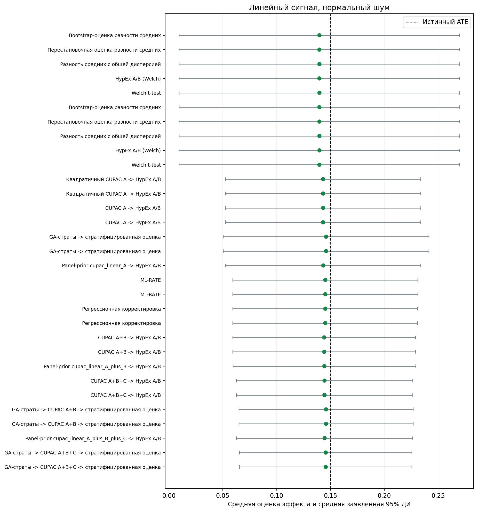
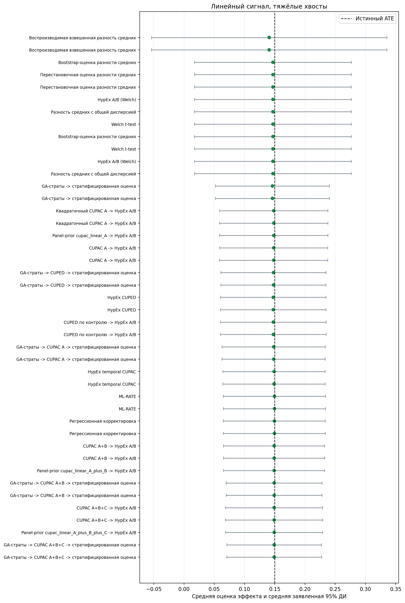
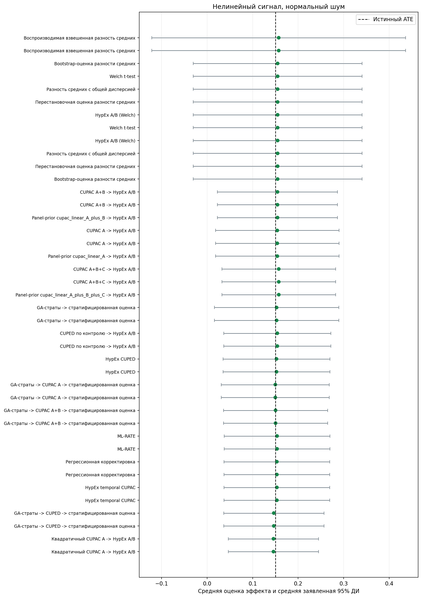
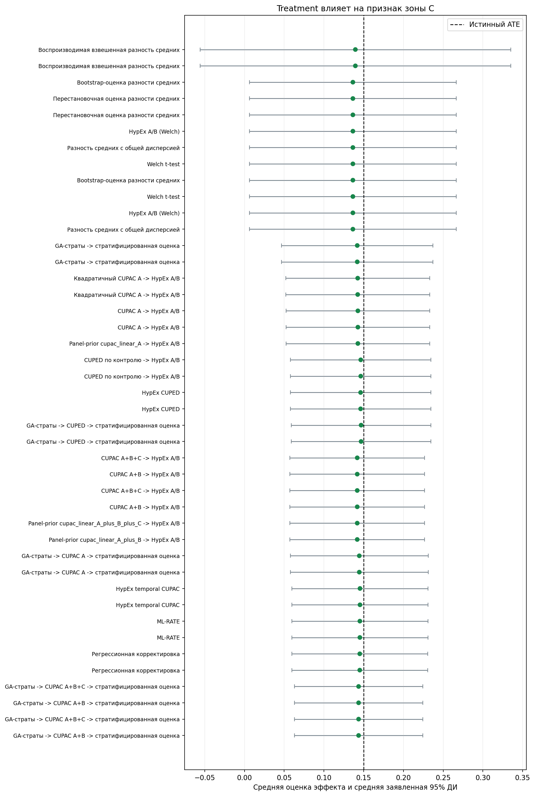
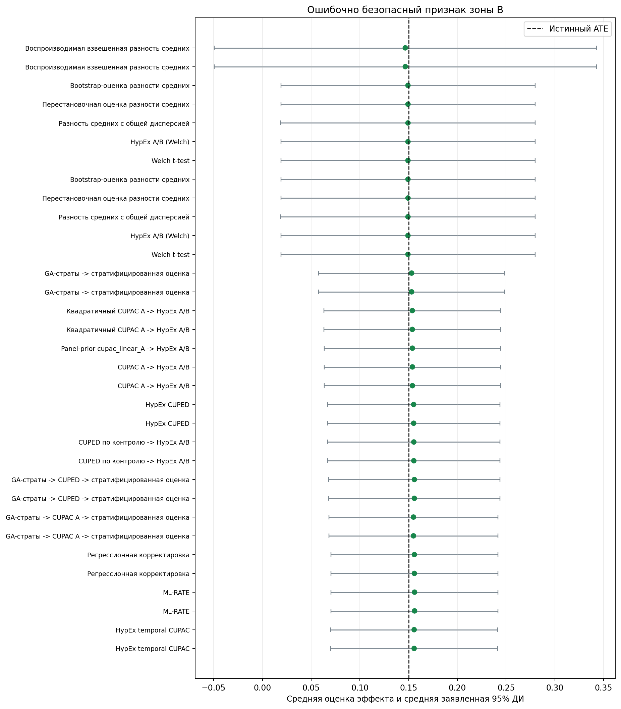

# Гонка аналитических пайплайнов VarWar v2

## Короткий вывод

Сравниваются полные аналитические пайплайны, а не изолированные примитивы. Сначала проверяются смещение, FPR и покрытие; только после этого рассматриваются дисперсия, мощность и стоимость.

- **Линейный сигнал, нормальный шум.** Есть выбранные пайплайны в нескольких информационных и временных контурах; см. отдельные строки отбора ниже.
- **Линейный сигнал, тяжёлые хвосты.** Есть выбранные пайплайны в нескольких информационных и временных контурах; см. отдельные строки отбора ниже.
- **Нелинейный сигнал, нормальный шум.** Есть выбранные пайплайны в нескольких информационных и временных контурах; см. отдельные строки отбора ниже.
- **Treatment влияет на признак зоны C.** Есть выбранные пайплайны в нескольких информационных и временных контурах; см. отдельные строки отбора ниже.
- **Ошибочно безопасный признак зоны B.** Есть выбранные пайплайны в нескольких информационных и временных контурах; см. отдельные строки отбора ниже.
- **Нерепрезентативная выборка и известная целевая популяция.** Отбор не дал кандидата после заданного диагностического экрана.

## Постановка

- Monte Carlo повторов на H0 и H1: `100`.
- Строк в одном эксперименте: `2500`.
- Истинный средний эффект H1: `0.15`.
- Уровень значимости: `0.05`.
- H0 и H1 внутри повтора имеют одинаковые признаки, assignment и шум; отличается только добавленный treatment effect.
- Отдельной обучающей выборки нет: модель CUPAC A использует `lag2 -> lag1`, локальные CUPED/B/C оценивают коэффициенты по текущему контролю, а GA использует только pre-target тех же строк. Интеграционные HypEx CUPED/CUPAC сохраняют политику пакета и оценивают theta на всём текущем эксперименте.
- A — предэкспериментные признаки; B — экспертно безопасные признаки текущего периода и отдельная линейная корректировка; C — ещё одна линейная корректировка после смыслового отсева и проверок баланса, пропусков и распределения.
- Balance gate не доказывает причинную безопасность. Сценарий `misclassified_b` намеренно проверяет цену экспертной ошибки.

## Правило допуска

Для первичного R&D-экрана заранее заданы практические допуски: |bias| ≤ 0,02, FPR ≤ 8%, покрытие ≥ 92% и SE/SD от 0,80 до 1,20. Также требуются 100% успешных запусков.
Прохождение экрана не доказывает статистическую валидность и не является результатом множественной проверки. Точные биномиальные интервалы FPR и power приведены для оценки неопределённости Monte Carlo.
Винзоризация вынесена в отдельный estimand и не участвует в рейтинге исходного ATE.

## Каталог гонки

| pipeline | pipeline_name_ru | components | estimand | pipeline_tier | predecessor_pipeline |
| --- | --- | --- | --- | --- | --- |
| welch | Welch t-test | welch_mean_diff | ATE | confirmatory |  |
| hypex_ab | HypEx A/B (Welch) | hypex_ab | ATE | integration_parity | welch |
| pooled_mean_diff | Разность средних с общей дисперсией | pooled_mean_diff | ATE | exploratory | welch |
| randomized_weighted_mean_diff | Воспроизводимая взвешенная разность средних | randomized_weighted_mean_diff | Взвешенный ATE | exploratory | welch |
| permutation_mean_diff | Перестановочная оценка разности средних | permutation_mean_diff | ATE | exploratory | welch |
| bootstrap_mean_diff | Bootstrap-оценка разности средних | bootstrap_mean_diff | ATE | exploratory | welch |
| hypex_cuped | HypEx CUPED | hypex_cuped -> hypex_ab | ATE | integration_parity | hypex_ab |
| cuped_control__hypex_ab | CUPED по контролю -> HypEx A/B | cuped_control -> hypex_ab | ATE | confirmatory | hypex_ab |
| hypex_cupac_temporal | HypEx temporal CUPAC | hypex_cupac_temporal -> hypex_ab | ATE | integration_parity | hypex_ab |
| cupac_linear_A__hypex_ab | CUPAC A -> HypEx A/B | cupac_linear_A -> hypex_ab | ATE | confirmatory | hypex_ab |
| cupac_linear_A_plus_B__hypex_ab | CUPAC A+B -> HypEx A/B | cupac_linear_A_plus_B -> hypex_ab | ATE | exploratory | cupac_linear_A__hypex_ab |
| cupac_linear_A_plus_B_plus_C__hypex_ab | CUPAC A+B+C -> HypEx A/B | cupac_linear_A_plus_B_plus_C -> hypex_ab | ATE | exploratory | cupac_linear_A_plus_B__hypex_ab |
| cupac_quadratic_A__hypex_ab | Квадратичный CUPAC A -> HypEx A/B | cupac_quadratic_A -> hypex_ab | ATE | exploratory | cupac_linear_A__hypex_ab |
| regression_adjustment | Регрессионная корректировка | regression_adjustment | ATE | confirmatory | welch |
| ml_rate | ML-RATE | ml_rate | ATE | exploratory | welch |
| nearest_neighbor_matching | Matching ближайшего соседа | nearest_neighbor_matching | ATE | exploratory |  |
| hypex_matching | Matching HypEx | hypex_matching | ATE | integration_parity |  |
| optimal_transport_matching | Глобальный matching оптимальным транспортом | optimal_transport_matching | ATE | exploratory |  |
| panel_prior_cupac_A__hypex_ab | Panel-prior cupac_linear_A -> HypEx A/B | panel_prior_cupac_A -> hypex_ab | ATE | confirmatory | hypex_ab |
| panel_prior_cupac_A_plus_B__hypex_ab | Panel-prior cupac_linear_A_plus_B -> HypEx A/B | panel_prior_cupac_A_plus_B -> hypex_ab | ATE | exploratory | panel_prior_cupac_A |
| panel_prior_cupac_A_plus_B_plus_C__hypex_ab | Panel-prior cupac_linear_A_plus_B_plus_C -> HypEx A/B | panel_prior_cupac_A_plus_B_plus_C -> hypex_ab | ATE | exploratory | panel_prior_cupac_A_plus_B |
| ga_strata__stratified | GA-страты -> стратифицированная оценка | genetic_strata_reducer -> stratified_mean_diff | ATE экспериментальной выборки | confirmatory | welch |
| ga_strata__cuped_control__stratified | GA-страты -> CUPED -> стратифицированная оценка | genetic_strata_reducer -> cuped_control -> stratified_mean_diff | ATE экспериментальной выборки | confirmatory | ga_strata__stratified |
| ga_strata__cupac_linear_A__stratified | GA-страты -> CUPAC A -> стратифицированная оценка | genetic_strata_reducer -> cupac_linear_A -> stratified_mean_diff | ATE экспериментальной выборки | confirmatory | ga_strata__stratified |
| ga_strata__cupac_linear_A_plus_B__stratified | GA-страты -> CUPAC A+B -> стратифицированная оценка | genetic_strata_reducer -> cupac_linear_A_plus_B -> stratified_mean_diff | ATE экспериментальной выборки | exploratory | ga_strata__cupac_linear_A__stratified |
| ga_strata__cupac_linear_A_plus_B_plus_C__stratified | GA-страты -> CUPAC A+B+C -> стратифицированная оценка | genetic_strata_reducer -> cupac_linear_A_plus_B_plus_C -> stratified_mean_diff | ATE экспериментальной выборки | exploratory | ga_strata__cupac_linear_A_plus_B__stratified |
| stratified_mean_diff | Стратификация с долями экспериментальной выборки | stratified_mean_diff | Sample ATE | confirmatory | welch |
| population_weighted_stratified | Постстратификация по известной популяции | population_weighted_stratified | Population ATE | confirmatory | stratified_mean_diff |
| calibration_reweighting | Entropy calibration по известным population moments | calibration_reweighting | Population ATE | confirmatory | stratified_mean_diff |

## Линейный сигнал, нормальный шум

Благоприятный базовый сценарий.

Есть выбранные пайплайны в нескольких информационных и временных контурах; см. отдельные строки отбора ниже.

### Отбор по сопоставимым контурам

| data_scenario | race_information_mode | temporal_mode | estimand_id | candidate_count | eligible_count | selected_pipeline | selected_pipeline_name_ru | selected_empirical_sd_h1 | selected_variance_reduction_vs_welch | selected_median_runtime_ms | selection_status | selection_criterion |
| --- | --- | --- | --- | --- | --- | --- | --- | --- | --- | --- | --- | --- |
| linear_gaussian | experiment_only | post_treatment_allowed | sample_ate | 4 | 4 | ga_strata__cupac_linear_A_plus_B_plus_C__stratified | GA-страты -> CUPAC A+B+C -> стратифицированная оценка | 0.04500540365901125 |  | 78.86024999606889 | выбран по минимальному SD | diagnostic screen + scientific sample size; min empirical SD, then runtime, then pipeline ID |
| linear_gaussian | panel_prior | post_treatment_allowed | sample_ate | 6 | 6 | ga_strata__cupac_linear_A_plus_B_plus_C__stratified | GA-страты -> CUPAC A+B+C -> стратифицированная оценка | 0.04500540365901125 |  | 79.86957500543213 | выбран по минимальному SD | diagnostic screen + scientific sample size; min empirical SD, then runtime, then pipeline ID |
| linear_gaussian | experiment_only | pre_treatment_only | sample_ate | 15 | 9 | regression_adjustment | Регрессионная корректировка | 0.04993280178724931 | 0.48514322012027167 | 3.565975002857158 | выбран по минимальному SD | diagnostic screen + scientific sample size; min empirical SD, then runtime, then pipeline ID |
| linear_gaussian | panel_prior | pre_treatment_only | sample_ate | 16 | 10 | regression_adjustment | Регрессионная корректировка | 0.04993280178724931 | 0.48514322012027167 | 3.5767750050581526 | выбран по минимальному SD | diagnostic screen + scientific sample size; min empirical SD, then runtime, then pipeline ID |

### Цепочка A/B/C

| Пайплайн | Режим информации | Временной доступ | Estimand | Повторов | Контур | Диагностический статус | Допущен в рейтинг | Bias | SD | SE/SD | VR к Welch, % | Инкремент, % | FPR, % | Power, % | Coverage, % | Время, мс |
| --- | --- | --- | --- | --- | --- | --- | --- | --- | --- | --- | --- | --- | --- | --- | --- | --- |
| CUPAC A+B+C -> HypEx A/B | experiment_only | post_treatment_allowed | sample_ate | 100 | exploratory | прошёл диагностический допуск | True | -0.0055 | 0.0461 | 0.907 |  | 9.0 | 7.0 | 91.0 | 93.0 | 61.44 |
| CUPAC A+B+C -> HypEx A/B | panel_prior | post_treatment_allowed | sample_ate | 100 | exploratory | прошёл диагностический допуск | True | -0.0055 | 0.0461 | 0.907 |  | 9.0 | 7.0 | 91.0 | 93.0 | 63.34 |
| CUPAC A+B -> HypEx A/B | experiment_only | post_treatment_allowed | sample_ate | 100 | exploratory | прошёл диагностический допуск | True | -0.0058 | 0.0483 | 0.897 |  |  | 8.0 | 90.0 | 92.0 | 59.29 |
| CUPAC A+B -> HypEx A/B | panel_prior | post_treatment_allowed | sample_ate | 100 | exploratory | прошёл диагностический допуск | True | -0.0058 | 0.0483 | 0.897 |  |  | 8.0 | 90.0 | 92.0 | 59.78 |
| HypEx temporal CUPAC | experiment_only | pre_treatment_only | sample_ate | 100 | integration_parity | FPR выше допуска | False | -0.0055 | 0.0511 | 0.86 | 46.2 | 46.2 | 10.0 | 90.0 | 90.0 | 172.99 |
| HypEx temporal CUPAC | panel_prior | pre_treatment_only | sample_ate | 100 | integration_parity | FPR выше допуска | False | -0.0055 | 0.0511 | 0.86 | 46.2 | 46.2 | 10.0 | 90.0 | 90.0 | 178.47 |
| CUPAC A -> HypEx A/B | experiment_only | pre_treatment_only | sample_ate | 100 | confirmatory | прошёл диагностический допуск | True | -0.0068 | 0.0527 | 0.878 | 42.7 | 42.7 | 8.0 | 86.0 | 92.0 | 56.7 |
| CUPAC A -> HypEx A/B | panel_prior | pre_treatment_only | sample_ate | 100 | confirmatory | прошёл диагностический допуск | True | -0.0068 | 0.0527 | 0.878 | 42.7 | 42.7 | 8.0 | 86.0 | 92.0 | 58.71 |
| HypEx A/B (Welch) | experiment_only | pre_treatment_only | sample_ate | 100 | integration_parity | прошёл диагностический допуск | True | -0.0102 | 0.0696 | 0.955 | 0.0 | 0.0 | 5.0 | 59.0 | 95.0 | 51.09 |
| HypEx A/B (Welch) | panel_prior | pre_treatment_only | sample_ate | 100 | integration_parity | прошёл диагностический допуск | True | -0.0102 | 0.0696 | 0.955 | 0.0 | 0.0 | 5.0 | 59.0 | 95.0 | 52.5 |

### Все пайплайны

| Пайплайн | Режим информации | Временной доступ | Estimand | Повторов | Контур | Диагностический статус | Допущен в рейтинг | Bias | SD | SE/SD | VR к Welch, % | Инкремент, % | FPR, % | Power, % | Coverage, % | Время, мс |
| --- | --- | --- | --- | --- | --- | --- | --- | --- | --- | --- | --- | --- | --- | --- | --- | --- |
| Глобальный matching оптимальным транспортом | experiment_only | pre_treatment_only | sample_ate | 100 | exploratory | смещение выше допуска | False | -0.1488 | 0.0184 | 1.69 | 93.0 |  | 0.0 | 0.0 | 0.0 | 209.44 |
| Глобальный matching оптимальным транспортом | panel_prior | pre_treatment_only | sample_ate | 100 | exploratory | смещение выше допуска | False | -0.1488 | 0.0184 | 1.69 | 93.0 |  | 0.0 | 0.0 | 0.0 | 211.88 |
| Matching ближайшего соседа | experiment_only | pre_treatment_only | sample_ate | 100 | exploratory | смещение выше допуска | False | -0.1511 | 0.0205 | 1.51 | 91.3 |  | 0.0 | 0.0 | 0.0 | 6.73 |
| Matching ближайшего соседа | panel_prior | pre_treatment_only | sample_ate | 100 | exploratory | смещение выше допуска | False | -0.1511 | 0.0205 | 1.51 | 91.3 |  | 0.0 | 0.0 | 0.0 | 7.03 |
| GA-страты -> CUPAC A+B+C -> стратифицированная оценка | experiment_only | post_treatment_allowed | sample_ate | 100 | exploratory | прошёл диагностический допуск | True | -0.0044 | 0.045 | 0.909 |  | 4.6 | 5.0 | 91.0 | 95.0 | 78.86 |
| GA-страты -> CUPAC A+B+C -> стратифицированная оценка | panel_prior | post_treatment_allowed | sample_ate | 100 | exploratory | прошёл диагностический допуск | True | -0.0044 | 0.045 | 0.909 |  | 4.6 | 5.0 | 91.0 | 95.0 | 79.87 |
| Panel-prior cupac_linear_A_plus_B_plus_C -> HypEx A/B | panel_prior | post_treatment_allowed | sample_ate | 100 | exploratory | прошёл диагностический допуск | True | -0.0054 | 0.0461 | 0.907 |  |  | 7.0 | 91.0 | 93.0 | 68.62 |
| GA-страты -> CUPAC A+B -> стратифицированная оценка | experiment_only | post_treatment_allowed | sample_ate | 100 | exploratory | прошёл диагностический допуск | True | -0.0041 | 0.0461 | 0.896 |  |  | 7.0 | 92.0 | 93.0 | 73.83 |
| GA-страты -> CUPAC A+B -> стратифицированная оценка | panel_prior | post_treatment_allowed | sample_ate | 100 | exploratory | прошёл диагностический допуск | True | -0.0041 | 0.0461 | 0.896 |  |  | 7.0 | 92.0 | 93.0 | 75.33 |
| CUPAC A+B+C -> HypEx A/B | experiment_only | post_treatment_allowed | sample_ate | 100 | exploratory | прошёл диагностический допуск | True | -0.0055 | 0.0461 | 0.907 |  | 9.0 | 7.0 | 91.0 | 93.0 | 61.44 |
| CUPAC A+B+C -> HypEx A/B | panel_prior | post_treatment_allowed | sample_ate | 100 | exploratory | прошёл диагностический допуск | True | -0.0055 | 0.0461 | 0.907 |  | 9.0 | 7.0 | 91.0 | 93.0 | 63.34 |
| Panel-prior cupac_linear_A_plus_B -> HypEx A/B | panel_prior | post_treatment_allowed | sample_ate | 100 | exploratory | прошёл диагностический допуск | True | -0.0056 | 0.0482 | 0.898 |  |  | 8.0 | 90.0 | 92.0 | 65.24 |
| CUPAC A+B -> HypEx A/B | panel_prior | post_treatment_allowed | sample_ate | 100 | exploratory | прошёл диагностический допуск | True | -0.0058 | 0.0483 | 0.897 |  |  | 8.0 | 90.0 | 92.0 | 59.78 |
| CUPAC A+B -> HypEx A/B | experiment_only | post_treatment_allowed | sample_ate | 100 | exploratory | прошёл диагностический допуск | True | -0.0058 | 0.0483 | 0.897 |  |  | 8.0 | 90.0 | 92.0 | 59.29 |
| Регрессионная корректировка | experiment_only | pre_treatment_only | sample_ate | 100 | confirmatory | прошёл диагностический допуск | True | -0.0048 | 0.0499 | 0.877 | 48.5 | 48.5 | 8.0 | 90.0 | 92.0 | 3.57 |
| Регрессионная корректировка | panel_prior | pre_treatment_only | sample_ate | 100 | confirmatory | прошёл диагностический допуск | True | -0.0048 | 0.0499 | 0.877 | 48.5 | 48.5 | 8.0 | 90.0 | 92.0 | 3.58 |
| ML-RATE | experiment_only | pre_treatment_only | sample_ate | 100 | exploratory | прошёл диагностический допуск | True | -0.0047 | 0.05 | 0.878 | 48.4 | 48.4 | 8.0 | 90.0 | 92.0 | 13.67 |
| ML-RATE | panel_prior | pre_treatment_only | sample_ate | 100 | exploratory | прошёл диагностический допуск | True | -0.0047 | 0.05 | 0.878 | 48.4 | 48.4 | 8.0 | 90.0 | 92.0 | 13.81 |
| GA-страты -> CUPAC A -> стратифицированная оценка | panel_prior | pre_treatment_only | sample_ate | 100 | confirmatory | FPR выше допуска | False | -0.0052 | 0.0505 | 0.878 | 47.3 | 8.0 | 9.0 | 89.0 | 91.0 | 72.46 |
| GA-страты -> CUPAC A -> стратифицированная оценка | experiment_only | pre_treatment_only | sample_ate | 100 | confirmatory | FPR выше допуска | False | -0.0052 | 0.0505 | 0.878 | 47.3 | 8.0 | 9.0 | 89.0 | 91.0 | 84.49 |
| HypEx temporal CUPAC | experiment_only | pre_treatment_only | sample_ate | 100 | integration_parity | FPR выше допуска | False | -0.0055 | 0.0511 | 0.86 | 46.2 | 46.2 | 10.0 | 90.0 | 90.0 | 172.99 |
| HypEx temporal CUPAC | panel_prior | pre_treatment_only | sample_ate | 100 | integration_parity | FPR выше допуска | False | -0.0055 | 0.0511 | 0.86 | 46.2 | 46.2 | 10.0 | 90.0 | 90.0 | 178.47 |
| Panel-prior cupac_linear_A -> HypEx A/B | panel_prior | pre_treatment_only | sample_ate | 100 | confirmatory | прошёл диагностический допуск | True | -0.0067 | 0.0526 | 0.879 |  |  | 8.0 | 86.0 | 92.0 | 64.1 |
| GA-страты -> стратифицированная оценка | experiment_only | pre_treatment_only | sample_ate | 100 | confirmatory | прошёл диагностический допуск | True | -0.0041 | 0.0527 | 0.925 | 42.7 | 42.7 | 6.0 | 84.0 | 94.0 | 64.89 |
| GA-страты -> стратифицированная оценка | panel_prior | pre_treatment_only | sample_ate | 100 | confirmatory | прошёл диагностический допуск | True | -0.0041 | 0.0527 | 0.925 | 42.7 | 42.7 | 6.0 | 84.0 | 94.0 | 66.15 |
| CUPAC A -> HypEx A/B | panel_prior | pre_treatment_only | sample_ate | 100 | confirmatory | прошёл диагностический допуск | True | -0.0068 | 0.0527 | 0.878 | 42.7 | 42.7 | 8.0 | 86.0 | 92.0 | 58.71 |
| CUPAC A -> HypEx A/B | experiment_only | pre_treatment_only | sample_ate | 100 | confirmatory | прошёл диагностический допуск | True | -0.0068 | 0.0527 | 0.878 | 42.7 | 42.7 | 8.0 | 86.0 | 92.0 | 56.7 |
| Квадратичный CUPAC A -> HypEx A/B | experiment_only | pre_treatment_only | sample_ate | 100 | exploratory | прошёл диагностический допуск | True | -0.0068 | 0.0529 | 0.874 | 42.1 | -1.0 | 8.0 | 87.0 | 92.0 | 54.55 |
| Квадратичный CUPAC A -> HypEx A/B | panel_prior | pre_treatment_only | sample_ate | 100 | exploratory | прошёл диагностический допуск | True | -0.0068 | 0.0529 | 0.874 | 42.1 | -1.0 | 8.0 | 87.0 | 92.0 | 56.62 |
| GA-страты -> CUPED -> стратифицированная оценка | experiment_only | pre_treatment_only | sample_ate | 100 | confirmatory | FPR выше допуска | False | -0.0071 | 0.0534 | 0.842 | 41.1 | -3.0 | 9.0 | 88.0 | 91.0 | 65.99 |
| GA-страты -> CUPED -> стратифицированная оценка | panel_prior | pre_treatment_only | sample_ate | 100 | confirmatory | FPR выше допуска | False | -0.0071 | 0.0534 | 0.842 | 41.1 | -3.0 | 9.0 | 88.0 | 91.0 | 67.38 |
| CUPED по контролю -> HypEx A/B | panel_prior | pre_treatment_only | sample_ate | 100 | confirmatory | FPR выше допуска | False | -0.0073 | 0.0545 | 0.831 | 38.7 | 38.7 | 10.0 | 88.0 | 90.0 | 52.29 |
| CUPED по контролю -> HypEx A/B | experiment_only | pre_treatment_only | sample_ate | 100 | confirmatory | FPR выше допуска | False | -0.0073 | 0.0545 | 0.831 | 38.7 | 38.7 | 10.0 | 88.0 | 90.0 | 52.45 |
| HypEx CUPED | experiment_only | pre_treatment_only | sample_ate | 100 | integration_parity | FPR выше допуска | False | -0.0074 | 0.0546 | 0.829 | 38.4 | 38.4 | 10.0 | 88.0 | 90.0 | 101.39 |
| HypEx CUPED | panel_prior | pre_treatment_only | sample_ate | 100 | integration_parity | FPR выше допуска | False | -0.0074 | 0.0546 | 0.829 | 38.4 | 38.4 | 10.0 | 88.0 | 90.0 | 103.94 |
| Matching HypEx | experiment_only | pre_treatment_only | sample_ate | 100 | integration_parity | SE/SD вне допуска | False | -0.0013 | 0.0569 | 1.237 | 33.1 |  | 2.0 | 58.0 | 98.0 | 513.26 |
| Matching HypEx | panel_prior | pre_treatment_only | sample_ate | 100 | integration_parity | SE/SD вне допуска | False | -0.0013 | 0.0569 | 1.237 | 33.1 |  | 2.0 | 58.0 | 98.0 | 535.61 |
| Перестановочная оценка разности средних | experiment_only | pre_treatment_only | sample_ate | 100 | exploratory | прошёл диагностический допуск | True | -0.0102 | 0.0696 | 0.955 | 0.0 | 0.0 | 5.0 | 58.0 | 95.0 | 57.36 |
| Перестановочная оценка разности средних | panel_prior | pre_treatment_only | sample_ate | 100 | exploratory | прошёл диагностический допуск | True | -0.0102 | 0.0696 | 0.955 | 0.0 | 0.0 | 5.0 | 58.0 | 95.0 | 59.05 |
| Разность средних с общей дисперсией | panel_prior | pre_treatment_only | sample_ate | 100 | exploratory | прошёл диагностический допуск | True | -0.0102 | 0.0696 | 0.955 | 0.0 | 0.0 | 5.0 | 59.0 | 95.0 | 0.63 |
| HypEx A/B (Welch) | panel_prior | pre_treatment_only | sample_ate | 100 | integration_parity | прошёл диагностический допуск | True | -0.0102 | 0.0696 | 0.955 | 0.0 | 0.0 | 5.0 | 59.0 | 95.0 | 52.5 |
| Welch t-test | panel_prior | pre_treatment_only | sample_ate | 100 | confirmatory | прошёл диагностический допуск | True | -0.0102 | 0.0696 | 0.955 | 0.0 |  | 5.0 | 59.0 | 95.0 | 0.84 |
| Bootstrap-оценка разности средних | experiment_only | pre_treatment_only | sample_ate | 100 | exploratory | прошёл диагностический допуск | True | -0.0102 | 0.0696 | 0.955 | 0.0 | 0.0 | 4.0 | 58.0 | 95.0 | 25.39 |
| Разность средних с общей дисперсией | experiment_only | pre_treatment_only | sample_ate | 100 | exploratory | прошёл диагностический допуск | True | -0.0102 | 0.0696 | 0.955 | 0.0 | 0.0 | 5.0 | 59.0 | 95.0 | 0.63 |
| HypEx A/B (Welch) | experiment_only | pre_treatment_only | sample_ate | 100 | integration_parity | прошёл диагностический допуск | True | -0.0102 | 0.0696 | 0.955 | 0.0 | 0.0 | 5.0 | 59.0 | 95.0 | 51.09 |
| Welch t-test | experiment_only | pre_treatment_only | sample_ate | 100 | confirmatory | прошёл диагностический допуск | True | -0.0102 | 0.0696 | 0.955 | 0.0 |  | 5.0 | 59.0 | 95.0 | 0.85 |
| Bootstrap-оценка разности средних | panel_prior | pre_treatment_only | sample_ate | 100 | exploratory | прошёл диагностический допуск | True | -0.0102 | 0.0696 | 0.955 | 0.0 | 0.0 | 4.0 | 58.0 | 95.0 | 26.67 |
| Воспроизводимая взвешенная разность средних | experiment_only | pre_treatment_only | sample_ate | 100 | exploratory | смещение выше допуска | False | -0.0204 | 0.1128 | 0.886 | -162.7 | -162.7 | 9.0 | 27.0 | 91.0 | 1.81 |
| Воспроизводимая взвешенная разность средних | panel_prior | pre_treatment_only | sample_ate | 100 | exploratory | смещение выше допуска | False | -0.0204 | 0.1128 | 0.886 | -162.7 | -162.7 | 9.0 | 27.0 | 91.0 | 1.82 |

## Линейный сигнал, тяжёлые хвосты

Проверка устойчивости SE и выигрыша по дисперсии.

Есть выбранные пайплайны в нескольких информационных и временных контурах; см. отдельные строки отбора ниже.

### Отбор по сопоставимым контурам

| data_scenario | race_information_mode | temporal_mode | estimand_id | candidate_count | eligible_count | selected_pipeline | selected_pipeline_name_ru | selected_empirical_sd_h1 | selected_variance_reduction_vs_welch | selected_median_runtime_ms | selection_status | selection_criterion |
| --- | --- | --- | --- | --- | --- | --- | --- | --- | --- | --- | --- | --- |
| linear_heavy_tail | experiment_only | post_treatment_allowed | sample_ate | 4 | 4 | ga_strata__cupac_linear_A_plus_B_plus_C__stratified | GA-страты -> CUPAC A+B+C -> стратифицированная оценка | 0.037265833170796375 |  | 76.70099999450031 | выбран по минимальному SD | diagnostic screen + scientific sample size; min empirical SD, then runtime, then pipeline ID |
| linear_heavy_tail | panel_prior | post_treatment_allowed | sample_ate | 6 | 6 | ga_strata__cupac_linear_A_plus_B_plus_C__stratified | GA-страты -> CUPAC A+B+C -> стратифицированная оценка | 0.037265833170796375 |  | 77.48165000157314 | выбран по минимальному SD | diagnostic screen + scientific sample size; min empirical SD, then runtime, then pipeline ID |
| linear_heavy_tail | experiment_only | pre_treatment_only | sample_ate | 15 | 13 | regression_adjustment | Регрессионная корректировка | 0.03962129587103587 | 0.5888044392324163 | 3.769974999158876 | выбран по минимальному SD | diagnostic screen + scientific sample size; min empirical SD, then runtime, then pipeline ID |
| linear_heavy_tail | panel_prior | pre_treatment_only | sample_ate | 16 | 14 | regression_adjustment | Регрессионная корректировка | 0.03962129587103587 | 0.5888044392324163 | 3.5468000023684 | выбран по минимальному SD | diagnostic screen + scientific sample size; min empirical SD, then runtime, then pipeline ID |

### Цепочка A/B/C

| Пайплайн | Режим информации | Временной доступ | Estimand | Повторов | Контур | Диагностический статус | Допущен в рейтинг | Bias | SD | SE/SD | VR к Welch, % | Инкремент, % | FPR, % | Power, % | Coverage, % | Время, мс |
| --- | --- | --- | --- | --- | --- | --- | --- | --- | --- | --- | --- | --- | --- | --- | --- | --- |
| CUPAC A+B+C -> HypEx A/B | experiment_only | post_treatment_allowed | sample_ate | 100 | exploratory | прошёл диагностический допуск | True | -0.001 | 0.0375 | 1.094 |  | 8.2 | 2.0 | 97.0 | 98.0 | 63.98 |
| CUPAC A+B+C -> HypEx A/B | panel_prior | post_treatment_allowed | sample_ate | 100 | exploratory | прошёл диагностический допуск | True | -0.001 | 0.0375 | 1.094 |  | 8.2 | 2.0 | 97.0 | 98.0 | 64.97 |
| CUPAC A+B -> HypEx A/B | experiment_only | post_treatment_allowed | sample_ate | 100 | exploratory | прошёл диагностический допуск | True | -0.001 | 0.0391 | 1.088 |  |  | 2.0 | 94.0 | 98.0 | 61.69 |
| CUPAC A+B -> HypEx A/B | panel_prior | post_treatment_allowed | sample_ate | 100 | exploratory | прошёл диагностический допуск | True | -0.001 | 0.0391 | 1.088 |  |  | 2.0 | 94.0 | 98.0 | 61.62 |
| HypEx temporal CUPAC | experiment_only | pre_treatment_only | sample_ate | 100 | integration_parity | прошёл диагностический допуск | True | -0.0011 | 0.0397 | 1.085 | 58.6 | 58.6 | 3.0 | 96.0 | 97.0 | 179.89 |
| HypEx temporal CUPAC | panel_prior | pre_treatment_only | sample_ate | 100 | integration_parity | прошёл диагностический допуск | True | -0.0011 | 0.0397 | 1.085 | 58.6 | 58.6 | 3.0 | 96.0 | 97.0 | 181.88 |
| CUPAC A -> HypEx A/B | experiment_only | pre_treatment_only | sample_ate | 100 | confirmatory | прошёл диагностический допуск | True | -0.0017 | 0.0422 | 1.081 | 53.4 | 53.4 | 3.0 | 93.0 | 97.0 | 58.36 |
| CUPAC A -> HypEx A/B | panel_prior | pre_treatment_only | sample_ate | 100 | confirmatory | прошёл диагностический допуск | True | -0.0017 | 0.0422 | 1.081 | 53.4 | 53.4 | 3.0 | 93.0 | 97.0 | 59.74 |
| HypEx A/B (Welch) | experiment_only | pre_treatment_only | sample_ate | 100 | integration_parity | прошёл диагностический допуск | True | -0.0029 | 0.0618 | 1.069 | 0.0 | 0.0 | 3.0 | 59.0 | 97.0 | 51.02 |
| HypEx A/B (Welch) | panel_prior | pre_treatment_only | sample_ate | 100 | integration_parity | прошёл диагностический допуск | True | -0.0029 | 0.0618 | 1.069 | 0.0 | 0.0 | 3.0 | 59.0 | 97.0 | 53.42 |

### Все пайплайны

| Пайплайн | Режим информации | Временной доступ | Estimand | Повторов | Контур | Диагностический статус | Допущен в рейтинг | Bias | SD | SE/SD | VR к Welch, % | Инкремент, % | FPR, % | Power, % | Coverage, % | Время, мс |
| --- | --- | --- | --- | --- | --- | --- | --- | --- | --- | --- | --- | --- | --- | --- | --- | --- |
| Глобальный matching оптимальным транспортом | experiment_only | pre_treatment_only | sample_ate | 100 | exploratory | смещение выше допуска | False | -0.1488 | 0.0188 | 1.628 | 90.8 |  | 0.0 | 0.0 | 0.0 | 202.59 |
| Глобальный matching оптимальным транспортом | panel_prior | pre_treatment_only | sample_ate | 100 | exploratory | смещение выше допуска | False | -0.1488 | 0.0188 | 1.628 | 90.8 |  | 0.0 | 0.0 | 0.0 | 202.5 |
| Matching ближайшего соседа | experiment_only | pre_treatment_only | sample_ate | 100 | exploratory | смещение выше допуска | False | -0.1487 | 0.0229 | 1.33 | 86.2 |  | 0.0 | 0.0 | 0.0 | 7.05 |
| Matching ближайшего соседа | panel_prior | pre_treatment_only | sample_ate | 100 | exploratory | смещение выше допуска | False | -0.1487 | 0.0229 | 1.33 | 86.2 |  | 0.0 | 0.0 | 0.0 | 6.92 |
| GA-страты -> CUPAC A+B+C -> стратифицированная оценка | experiment_only | post_treatment_allowed | sample_ate | 100 | exploratory | прошёл диагностический допуск | True | -0.0009 | 0.0373 | 1.073 |  | 2.0 | 4.0 | 97.0 | 96.0 | 76.7 |
| GA-страты -> CUPAC A+B+C -> стратифицированная оценка | panel_prior | post_treatment_allowed | sample_ate | 100 | exploratory | прошёл диагностический допуск | True | -0.0009 | 0.0373 | 1.073 |  | 2.0 | 4.0 | 97.0 | 96.0 | 77.48 |
| Panel-prior cupac_linear_A_plus_B_plus_C -> HypEx A/B | panel_prior | post_treatment_allowed | sample_ate | 100 | exploratory | прошёл диагностический допуск | True | -0.0009 | 0.0375 | 1.094 |  |  | 2.0 | 96.0 | 98.0 | 68.94 |
| CUPAC A+B+C -> HypEx A/B | experiment_only | post_treatment_allowed | sample_ate | 100 | exploratory | прошёл диагностический допуск | True | -0.001 | 0.0375 | 1.094 |  | 8.2 | 2.0 | 97.0 | 98.0 | 63.98 |
| CUPAC A+B+C -> HypEx A/B | panel_prior | post_treatment_allowed | sample_ate | 100 | exploratory | прошёл диагностический допуск | True | -0.001 | 0.0375 | 1.094 |  | 8.2 | 2.0 | 97.0 | 98.0 | 64.97 |
| GA-страты -> CUPAC A+B -> стратифицированная оценка | experiment_only | post_treatment_allowed | sample_ate | 100 | exploratory | прошёл диагностический допуск | True | -0.001 | 0.0376 | 1.074 |  |  | 2.0 | 97.0 | 98.0 | 72.34 |
| GA-страты -> CUPAC A+B -> стратифицированная оценка | panel_prior | post_treatment_allowed | sample_ate | 100 | exploratory | прошёл диагностический допуск | True | -0.001 | 0.0376 | 1.074 |  |  | 2.0 | 97.0 | 98.0 | 74.69 |
| Panel-prior cupac_linear_A_plus_B -> HypEx A/B | panel_prior | post_treatment_allowed | sample_ate | 100 | exploratory | прошёл диагностический допуск | True | -0.0009 | 0.0391 | 1.089 |  |  | 2.0 | 94.0 | 98.0 | 64.92 |
| CUPAC A+B -> HypEx A/B | experiment_only | post_treatment_allowed | sample_ate | 100 | exploratory | прошёл диагностический допуск | True | -0.001 | 0.0391 | 1.088 |  |  | 2.0 | 94.0 | 98.0 | 61.69 |
| CUPAC A+B -> HypEx A/B | panel_prior | post_treatment_allowed | sample_ate | 100 | exploratory | прошёл диагностический допуск | True | -0.001 | 0.0391 | 1.088 |  |  | 2.0 | 94.0 | 98.0 | 61.62 |
| Регрессионная корректировка | experiment_only | pre_treatment_only | sample_ate | 100 | confirmatory | прошёл диагностический допуск | True | -0.0005 | 0.0396 | 1.085 | 58.9 | 58.9 | 2.0 | 95.0 | 98.0 | 3.77 |
| Регрессионная корректировка | panel_prior | pre_treatment_only | sample_ate | 100 | confirmatory | прошёл диагностический допуск | True | -0.0005 | 0.0396 | 1.085 | 58.9 | 58.9 | 2.0 | 95.0 | 98.0 | 3.55 |
| ML-RATE | panel_prior | pre_treatment_only | sample_ate | 100 | exploratory | прошёл диагностический допуск | True | -0.0004 | 0.0397 | 1.084 | 58.7 | 58.7 | 2.0 | 95.0 | 98.0 | 13.83 |
| ML-RATE | experiment_only | pre_treatment_only | sample_ate | 100 | exploratory | прошёл диагностический допуск | True | -0.0004 | 0.0397 | 1.084 | 58.7 | 58.7 | 2.0 | 95.0 | 98.0 | 14.12 |
| HypEx temporal CUPAC | experiment_only | pre_treatment_only | sample_ate | 100 | integration_parity | прошёл диагностический допуск | True | -0.0011 | 0.0397 | 1.085 | 58.6 | 58.6 | 3.0 | 96.0 | 97.0 | 179.89 |
| HypEx temporal CUPAC | panel_prior | pre_treatment_only | sample_ate | 100 | integration_parity | прошёл диагностический допуск | True | -0.0011 | 0.0397 | 1.085 | 58.6 | 58.6 | 3.0 | 96.0 | 97.0 | 181.88 |
| GA-страты -> CUPAC A -> стратифицированная оценка | panel_prior | pre_treatment_only | sample_ate | 100 | confirmatory | прошёл диагностический допуск | True | -0.0017 | 0.0407 | 1.072 | 56.7 | 22.8 | 3.0 | 96.0 | 97.0 | 70.91 |
| GA-страты -> CUPAC A -> стратифицированная оценка | experiment_only | pre_treatment_only | sample_ate | 100 | confirmatory | прошёл диагностический допуск | True | -0.0017 | 0.0407 | 1.072 | 56.7 | 22.8 | 3.0 | 96.0 | 97.0 | 70.27 |
| CUPED по контролю -> HypEx A/B | experiment_only | pre_treatment_only | sample_ate | 100 | confirmatory | прошёл диагностический допуск | True | -0.0023 | 0.042 | 1.061 | 53.9 | 53.9 | 6.0 | 92.0 | 94.0 | 51.84 |
| CUPED по контролю -> HypEx A/B | panel_prior | pre_treatment_only | sample_ate | 100 | confirmatory | прошёл диагностический допуск | True | -0.0023 | 0.042 | 1.061 | 53.9 | 53.9 | 6.0 | 92.0 | 94.0 | 55.61 |
| HypEx CUPED | experiment_only | pre_treatment_only | sample_ate | 100 | integration_parity | прошёл диагностический допуск | True | -0.0024 | 0.042 | 1.06 | 53.9 | 53.9 | 6.0 | 92.0 | 94.0 | 102.36 |
| HypEx CUPED | panel_prior | pre_treatment_only | sample_ate | 100 | integration_parity | прошёл диагностический допуск | True | -0.0024 | 0.042 | 1.06 | 53.9 | 53.9 | 6.0 | 92.0 | 94.0 | 106.98 |
| GA-страты -> CUPED -> стратифицированная оценка | experiment_only | pre_treatment_only | sample_ate | 100 | confirmatory | прошёл диагностический допуск | True | -0.002 | 0.042 | 1.053 | 53.8 | 17.6 | 4.0 | 93.0 | 96.0 | 63.44 |
| GA-страты -> CUPED -> стратифицированная оценка | panel_prior | pre_treatment_only | sample_ate | 100 | confirmatory | прошёл диагностический допуск | True | -0.002 | 0.042 | 1.053 | 53.8 | 17.6 | 4.0 | 93.0 | 96.0 | 66.03 |
| CUPAC A -> HypEx A/B | experiment_only | pre_treatment_only | sample_ate | 100 | confirmatory | прошёл диагностический допуск | True | -0.0017 | 0.0422 | 1.081 | 53.4 | 53.4 | 3.0 | 93.0 | 97.0 | 58.36 |
| CUPAC A -> HypEx A/B | panel_prior | pre_treatment_only | sample_ate | 100 | confirmatory | прошёл диагностический допуск | True | -0.0017 | 0.0422 | 1.081 | 53.4 | 53.4 | 3.0 | 93.0 | 97.0 | 59.74 |
| Panel-prior cupac_linear_A -> HypEx A/B | panel_prior | pre_treatment_only | sample_ate | 100 | confirmatory | прошёл диагностический допуск | True | -0.0015 | 0.0422 | 1.081 |  |  | 4.0 | 93.0 | 96.0 | 63.82 |
| Квадратичный CUPAC A -> HypEx A/B | experiment_only | pre_treatment_only | sample_ate | 100 | exploratory | прошёл диагностический допуск | True | -0.0016 | 0.0422 | 1.08 | 53.3 | -0.4 | 4.0 | 93.0 | 96.0 | 58.59 |
| Квадратичный CUPAC A -> HypEx A/B | panel_prior | pre_treatment_only | sample_ate | 100 | exploratory | прошёл диагностический допуск | True | -0.0016 | 0.0422 | 1.08 | 53.3 | -0.4 | 4.0 | 93.0 | 96.0 | 56.97 |
| GA-страты -> стратифицированная оценка | experiment_only | pre_treatment_only | sample_ate | 100 | confirmatory | прошёл диагностический допуск | True | -0.0037 | 0.0463 | 1.037 | 43.9 | 43.9 | 3.0 | 82.0 | 97.0 | 61.96 |
| GA-страты -> стратифицированная оценка | panel_prior | pre_treatment_only | sample_ate | 100 | confirmatory | прошёл диагностический допуск | True | -0.0037 | 0.0463 | 1.037 | 43.9 | 43.9 | 3.0 | 82.0 | 97.0 | 64.68 |
| Matching HypEx | experiment_only | pre_treatment_only | sample_ate | 100 | integration_parity | SE/SD вне допуска | False | -0.0054 | 0.0501 | 1.389 | 34.3 |  | 0.0 | 54.0 | 100.0 | 523.87 |
| Matching HypEx | panel_prior | pre_treatment_only | sample_ate | 100 | integration_parity | SE/SD вне допуска | False | -0.0054 | 0.0501 | 1.389 | 34.3 |  | 0.0 | 54.0 | 100.0 | 517.88 |
| HypEx A/B (Welch) | panel_prior | pre_treatment_only | sample_ate | 100 | integration_parity | прошёл диагностический допуск | True | -0.0029 | 0.0618 | 1.069 | 0.0 | 0.0 | 3.0 | 59.0 | 97.0 | 53.42 |
| Bootstrap-оценка разности средних | experiment_only | pre_treatment_only | sample_ate | 100 | exploratory | прошёл диагностический допуск | True | -0.0029 | 0.0618 | 1.069 | 0.0 | 0.0 | 3.0 | 59.0 | 98.0 | 26.41 |
| Перестановочная оценка разности средних | panel_prior | pre_treatment_only | sample_ate | 100 | exploratory | прошёл диагностический допуск | True | -0.0029 | 0.0618 | 1.069 | 0.0 | 0.0 | 2.0 | 58.0 | 97.0 | 60.16 |
| Bootstrap-оценка разности средних | panel_prior | pre_treatment_only | sample_ate | 100 | exploratory | прошёл диагностический допуск | True | -0.0029 | 0.0618 | 1.069 | 0.0 | 0.0 | 3.0 | 59.0 | 98.0 | 26.9 |
| Перестановочная оценка разности средних | experiment_only | pre_treatment_only | sample_ate | 100 | exploratory | прошёл диагностический допуск | True | -0.0029 | 0.0618 | 1.069 | 0.0 | 0.0 | 2.0 | 58.0 | 97.0 | 59.26 |
| Разность средних с общей дисперсией | experiment_only | pre_treatment_only | sample_ate | 100 | exploratory | прошёл диагностический допуск | True | -0.0029 | 0.0618 | 1.069 | 0.0 | 0.0 | 3.0 | 59.0 | 97.0 | 0.63 |
| HypEx A/B (Welch) | experiment_only | pre_treatment_only | sample_ate | 100 | integration_parity | прошёл диагностический допуск | True | -0.0029 | 0.0618 | 1.069 | 0.0 | 0.0 | 3.0 | 59.0 | 97.0 | 51.02 |
| Welch t-test | experiment_only | pre_treatment_only | sample_ate | 100 | confirmatory | прошёл диагностический допуск | True | -0.0029 | 0.0618 | 1.069 | 0.0 |  | 3.0 | 59.0 | 97.0 | 0.84 |
| Welch t-test | panel_prior | pre_treatment_only | sample_ate | 100 | confirmatory | прошёл диагностический допуск | True | -0.0029 | 0.0618 | 1.069 | 0.0 |  | 3.0 | 59.0 | 97.0 | 0.88 |
| Разность средних с общей дисперсией | panel_prior | pre_treatment_only | sample_ate | 100 | exploratory | прошёл диагностический допуск | True | -0.0029 | 0.0618 | 1.069 | 0.0 | 0.0 | 3.0 | 59.0 | 97.0 | 0.64 |
| Воспроизводимая взвешенная разность средних | experiment_only | pre_treatment_only | sample_ate | 100 | exploratory | прошёл диагностический допуск | True | -0.0092 | 0.0997 | 0.996 | -160.4 | -160.4 | 5.0 | 26.0 | 95.0 | 1.8 |
| Воспроизводимая взвешенная разность средних | panel_prior | pre_treatment_only | sample_ate | 100 | exploratory | прошёл диагностический допуск | True | -0.0092 | 0.0997 | 0.996 | -160.4 | -160.4 | 5.0 | 26.0 | 95.0 | 1.86 |

## Нелинейный сигнал, нормальный шум

Проверка линейных и квадратичных корректировок.

Есть выбранные пайплайны в нескольких информационных и временных контурах; см. отдельные строки отбора ниже.

### Отбор по сопоставимым контурам

| data_scenario | race_information_mode | temporal_mode | estimand_id | candidate_count | eligible_count | selected_pipeline | selected_pipeline_name_ru | selected_empirical_sd_h1 | selected_variance_reduction_vs_welch | selected_median_runtime_ms | selection_status | selection_criterion |
| --- | --- | --- | --- | --- | --- | --- | --- | --- | --- | --- | --- | --- |
| nonlinear_gaussian | experiment_only | pre_treatment_only | sample_ate | 15 | 13 | cupac_quadratic_A__hypex_ab | Квадратичный CUPAC A -> HypEx A/B | 0.05162410857044447 | 0.7345194684896964 | 56.42582500149729 | выбран по минимальному SD | diagnostic screen + scientific sample size; min empirical SD, then runtime, then pipeline ID |
| nonlinear_gaussian | panel_prior | pre_treatment_only | sample_ate | 16 | 14 | cupac_quadratic_A__hypex_ab | Квадратичный CUPAC A -> HypEx A/B | 0.05162410857044447 | 0.7345194684896964 | 55.80999999801861 | выбран по минимальному SD | diagnostic screen + scientific sample size; min empirical SD, then runtime, then pipeline ID |
| nonlinear_gaussian | experiment_only | post_treatment_allowed | sample_ate | 4 | 3 | ga_strata__cupac_linear_A_plus_B__stratified | GA-страты -> CUPAC A+B -> стратифицированная оценка | 0.06606608549445324 |  | 74.7537250026653 | выбран по минимальному SD | diagnostic screen + scientific sample size; min empirical SD, then runtime, then pipeline ID |
| nonlinear_gaussian | panel_prior | post_treatment_allowed | sample_ate | 6 | 5 | ga_strata__cupac_linear_A_plus_B__stratified | GA-страты -> CUPAC A+B -> стратифицированная оценка | 0.06606608549445324 |  | 76.35772500361782 | выбран по минимальному SD | diagnostic screen + scientific sample size; min empirical SD, then runtime, then pipeline ID |

### Цепочка A/B/C

| Пайплайн | Режим информации | Временной доступ | Estimand | Повторов | Контур | Диагностический статус | Допущен в рейтинг | Bias | SD | SE/SD | VR к Welch, % | Инкремент, % | FPR, % | Power, % | Coverage, % | Время, мс |
| --- | --- | --- | --- | --- | --- | --- | --- | --- | --- | --- | --- | --- | --- | --- | --- | --- |
| HypEx temporal CUPAC | experiment_only | pre_treatment_only | sample_ate | 100 | integration_parity | прошёл диагностический допуск | True | 0.0033 | 0.0654 | 0.906 | 57.4 | 57.4 | 6.0 | 70.0 | 94.0 | 177.94 |
| HypEx temporal CUPAC | panel_prior | pre_treatment_only | sample_ate | 100 | integration_parity | прошёл диагностический допуск | True | 0.0033 | 0.0654 | 0.906 | 57.4 | 57.4 | 6.0 | 70.0 | 94.0 | 184.05 |
| CUPAC A+B+C -> HypEx A/B | experiment_only | post_treatment_allowed | sample_ate | 100 | exploratory | прошёл диагностический допуск | True | 0.0074 | 0.0754 | 0.845 |  | 4.1 | 8.0 | 66.0 | 93.0 | 63.61 |
| CUPAC A+B+C -> HypEx A/B | panel_prior | post_treatment_allowed | sample_ate | 100 | exploratory | прошёл диагностический допуск | True | 0.0074 | 0.0754 | 0.845 |  | 4.1 | 8.0 | 66.0 | 93.0 | 63.85 |
| CUPAC A -> HypEx A/B | experiment_only | pre_treatment_only | sample_ate | 100 | confirmatory | прошёл диагностический допуск | True | 0.0041 | 0.0767 | 0.902 | 41.3 | 41.3 | 5.0 | 57.0 | 95.0 | 58.28 |
| CUPAC A -> HypEx A/B | panel_prior | pre_treatment_only | sample_ate | 100 | confirmatory | прошёл диагностический допуск | True | 0.0041 | 0.0767 | 0.902 | 41.3 | 41.3 | 5.0 | 57.0 | 95.0 | 59.32 |
| CUPAC A+B -> HypEx A/B | experiment_only | post_treatment_allowed | sample_ate | 100 | exploratory | прошёл диагностический допуск | True | 0.0046 | 0.0769 | 0.875 |  |  | 6.0 | 60.0 | 94.0 | 61.6 |
| CUPAC A+B -> HypEx A/B | panel_prior | post_treatment_allowed | sample_ate | 100 | exploratory | прошёл диагностический допуск | True | 0.0046 | 0.0769 | 0.875 |  |  | 6.0 | 60.0 | 94.0 | 61.15 |
| HypEx A/B (Welch) | experiment_only | pre_treatment_only | sample_ate | 100 | integration_parity | прошёл диагностический допуск | True | 0.0049 | 0.1002 | 0.944 | 0.0 | 0.0 | 6.0 | 43.0 | 94.0 | 52.77 |
| HypEx A/B (Welch) | panel_prior | pre_treatment_only | sample_ate | 100 | integration_parity | прошёл диагностический допуск | True | 0.0049 | 0.1002 | 0.944 | 0.0 | 0.0 | 6.0 | 43.0 | 94.0 | 53.4 |

### Все пайплайны

| Пайплайн | Режим информации | Временной доступ | Estimand | Повторов | Контур | Диагностический статус | Допущен в рейтинг | Bias | SD | SE/SD | VR к Welch, % | Инкремент, % | FPR, % | Power, % | Coverage, % | Время, мс |
| --- | --- | --- | --- | --- | --- | --- | --- | --- | --- | --- | --- | --- | --- | --- | --- | --- |
| Matching ближайшего соседа | experiment_only | pre_treatment_only | sample_ate | 100 | exploratory | смещение выше допуска | False | -0.1264 | 0.0264 | 1.225 | 93.1 |  | 6.0 | 6.0 | 2.0 | 6.82 |
| Matching ближайшего соседа | panel_prior | pre_treatment_only | sample_ate | 100 | exploratory | смещение выше допуска | False | -0.1264 | 0.0264 | 1.225 | 93.1 |  | 6.0 | 6.0 | 2.0 | 6.76 |
| Глобальный matching оптимальным транспортом | experiment_only | pre_treatment_only | sample_ate | 100 | exploratory | смещение выше допуска | False | -0.1132 | 0.0281 | 1.162 | 92.1 |  | 14.0 | 15.0 | 4.0 | 201.15 |
| Глобальный matching оптимальным транспортом | panel_prior | pre_treatment_only | sample_ate | 100 | exploratory | смещение выше допуска | False | -0.1132 | 0.0281 | 1.162 | 92.1 |  | 14.0 | 15.0 | 4.0 | 201.02 |
| Matching HypEx | experiment_only | pre_treatment_only | sample_ate | 100 | integration_parity | SE/SD вне допуска | False | -0.0058 | 0.0508 | 1.442 | 74.3 |  | 1.0 | 46.0 | 99.0 | 515.95 |
| Matching HypEx | panel_prior | pre_treatment_only | sample_ate | 100 | integration_parity | SE/SD вне допуска | False | -0.0058 | 0.0508 | 1.442 | 74.3 |  | 1.0 | 46.0 | 99.0 | 513.05 |
| Квадратичный CUPAC A -> HypEx A/B | experiment_only | pre_treatment_only | sample_ate | 100 | exploratory | прошёл диагностический допуск | True | -0.0043 | 0.0516 | 0.98 | 73.5 | 54.7 | 8.0 | 87.0 | 92.0 | 56.43 |
| Квадратичный CUPAC A -> HypEx A/B | panel_prior | pre_treatment_only | sample_ate | 100 | exploratory | прошёл диагностический допуск | True | -0.0043 | 0.0516 | 0.98 | 73.5 | 54.7 | 8.0 | 87.0 | 92.0 | 55.81 |
| GA-страты -> CUPED -> стратифицированная оценка | experiment_only | pre_treatment_only | sample_ate | 100 | confirmatory | прошёл диагностический допуск | True | -0.0035 | 0.0632 | 0.889 | 60.2 | 27.1 | 4.0 | 73.0 | 96.0 | 67.33 |
| GA-страты -> CUPED -> стратифицированная оценка | panel_prior | pre_treatment_only | sample_ate | 100 | confirmatory | прошёл диагностический допуск | True | -0.0035 | 0.0632 | 0.889 | 60.2 | 27.1 | 4.0 | 73.0 | 96.0 | 68.76 |
| HypEx temporal CUPAC | panel_prior | pre_treatment_only | sample_ate | 100 | integration_parity | прошёл диагностический допуск | True | 0.0033 | 0.0654 | 0.906 | 57.4 | 57.4 | 6.0 | 70.0 | 94.0 | 184.05 |
| HypEx temporal CUPAC | experiment_only | pre_treatment_only | sample_ate | 100 | integration_parity | прошёл диагностический допуск | True | 0.0033 | 0.0654 | 0.906 | 57.4 | 57.4 | 6.0 | 70.0 | 94.0 | 177.94 |
| Регрессионная корректировка | panel_prior | pre_treatment_only | sample_ate | 100 | confirmatory | прошёл диагностический допуск | True | 0.0032 | 0.0655 | 0.903 | 57.2 | 57.2 | 7.0 | 67.0 | 93.0 | 3.66 |
| Регрессионная корректировка | experiment_only | pre_treatment_only | sample_ate | 100 | confirmatory | прошёл диагностический допуск | True | 0.0032 | 0.0655 | 0.903 | 57.2 | 57.2 | 7.0 | 67.0 | 93.0 | 3.62 |
| ML-RATE | experiment_only | pre_treatment_only | sample_ate | 100 | exploratory | прошёл диагностический допуск | True | 0.0037 | 0.0657 | 0.903 | 57.0 | 57.0 | 7.0 | 67.0 | 93.0 | 13.8 |
| ML-RATE | panel_prior | pre_treatment_only | sample_ate | 100 | exploratory | прошёл диагностический допуск | True | 0.0037 | 0.0657 | 0.903 | 57.0 | 57.0 | 7.0 | 67.0 | 93.0 | 13.75 |
| GA-страты -> CUPAC A+B -> стратифицированная оценка | panel_prior | post_treatment_allowed | sample_ate | 100 | exploratory | прошёл диагностический допуск | True | 0.0004 | 0.0661 | 0.884 |  |  | 7.0 | 66.0 | 93.0 | 76.36 |
| GA-страты -> CUPAC A+B -> стратифицированная оценка | experiment_only | post_treatment_allowed | sample_ate | 100 | exploratory | прошёл диагностический допуск | True | 0.0004 | 0.0661 | 0.884 |  |  | 7.0 | 66.0 | 93.0 | 74.75 |
| GA-страты -> CUPAC A -> стратифицированная оценка | panel_prior | pre_treatment_only | sample_ate | 100 | confirmatory | прошёл диагностический допуск | True | -0.0002 | 0.0662 | 0.914 | 56.3 | 19.9 | 5.0 | 65.0 | 95.0 | 74.14 |
| GA-страты -> CUPAC A -> стратифицированная оценка | experiment_only | pre_treatment_only | sample_ate | 100 | confirmatory | прошёл диагностический допуск | True | -0.0002 | 0.0662 | 0.914 | 56.3 | 19.9 | 5.0 | 65.0 | 95.0 | 72.34 |
| HypEx CUPED | experiment_only | pre_treatment_only | sample_ate | 100 | integration_parity | прошёл диагностический допуск | True | 0.0024 | 0.0666 | 0.9 | 55.8 | 55.8 | 7.0 | 66.0 | 93.0 | 105.71 |
| HypEx CUPED | panel_prior | pre_treatment_only | sample_ate | 100 | integration_parity | прошёл диагностический допуск | True | 0.0024 | 0.0666 | 0.9 | 55.8 | 55.8 | 7.0 | 66.0 | 93.0 | 106.61 |
| CUPED по контролю -> HypEx A/B | panel_prior | pre_treatment_only | sample_ate | 100 | confirmatory | прошёл диагностический допуск | True | 0.0042 | 0.0671 | 0.895 | 55.1 | 55.1 | 8.0 | 67.0 | 94.0 | 53.66 |
| CUPED по контролю -> HypEx A/B | experiment_only | pre_treatment_only | sample_ate | 100 | confirmatory | прошёл диагностический допуск | True | 0.0042 | 0.0671 | 0.895 | 55.1 | 55.1 | 8.0 | 67.0 | 94.0 | 52.04 |
| GA-страты -> CUPAC A+B+C -> стратифицированная оценка | panel_prior | post_treatment_allowed | sample_ate | 100 | exploratory | FPR выше допуска | False | 0.0022 | 0.0681 | 0.844 |  | -6.4 | 11.0 | 68.0 | 88.0 | 79.56 |
| GA-страты -> CUPAC A+B+C -> стратифицированная оценка | experiment_only | post_treatment_allowed | sample_ate | 100 | exploratory | FPR выше допуска | False | 0.0022 | 0.0681 | 0.844 |  | -6.4 | 11.0 | 68.0 | 88.0 | 78.4 |
| GA-страты -> стратифицированная оценка | experiment_only | pre_treatment_only | sample_ate | 100 | confirmatory | прошёл диагностический допуск | True | 0.0027 | 0.074 | 0.941 | 45.4 | 45.4 | 4.0 | 56.0 | 95.0 | 65.46 |
| GA-страты -> стратифицированная оценка | panel_prior | pre_treatment_only | sample_ate | 100 | confirmatory | прошёл диагностический допуск | True | 0.0027 | 0.074 | 0.941 | 45.4 | 45.4 | 4.0 | 56.0 | 95.0 | 67.59 |
| Panel-prior cupac_linear_A_plus_B_plus_C -> HypEx A/B | panel_prior | post_treatment_allowed | sample_ate | 100 | exploratory | прошёл диагностический допуск | True | 0.0075 | 0.0752 | 0.846 |  |  | 8.0 | 67.0 | 93.0 | 68.54 |
| CUPAC A+B+C -> HypEx A/B | experiment_only | post_treatment_allowed | sample_ate | 100 | exploratory | прошёл диагностический допуск | True | 0.0074 | 0.0754 | 0.845 |  | 4.1 | 8.0 | 66.0 | 93.0 | 63.61 |
| CUPAC A+B+C -> HypEx A/B | panel_prior | post_treatment_allowed | sample_ate | 100 | exploratory | прошёл диагностический допуск | True | 0.0074 | 0.0754 | 0.845 |  | 4.1 | 8.0 | 66.0 | 93.0 | 63.85 |
| Panel-prior cupac_linear_A -> HypEx A/B | panel_prior | pre_treatment_only | sample_ate | 100 | confirmatory | прошёл диагностический допуск | True | 0.0042 | 0.0766 | 0.904 |  |  | 5.0 | 57.0 | 95.0 | 64.73 |
| CUPAC A -> HypEx A/B | panel_prior | pre_treatment_only | sample_ate | 100 | confirmatory | прошёл диагностический допуск | True | 0.0041 | 0.0767 | 0.902 | 41.3 | 41.3 | 5.0 | 57.0 | 95.0 | 59.32 |
| CUPAC A -> HypEx A/B | experiment_only | pre_treatment_only | sample_ate | 100 | confirmatory | прошёл диагностический допуск | True | 0.0041 | 0.0767 | 0.902 | 41.3 | 41.3 | 5.0 | 57.0 | 95.0 | 58.28 |
| Panel-prior cupac_linear_A_plus_B -> HypEx A/B | panel_prior | post_treatment_allowed | sample_ate | 100 | exploratory | прошёл диагностический допуск | True | 0.0047 | 0.0767 | 0.877 |  |  | 6.0 | 59.0 | 94.0 | 65.73 |
| CUPAC A+B -> HypEx A/B | panel_prior | post_treatment_allowed | sample_ate | 100 | exploratory | прошёл диагностический допуск | True | 0.0046 | 0.0769 | 0.875 |  |  | 6.0 | 60.0 | 94.0 | 61.15 |
| CUPAC A+B -> HypEx A/B | experiment_only | post_treatment_allowed | sample_ate | 100 | exploratory | прошёл диагностический допуск | True | 0.0046 | 0.0769 | 0.875 |  |  | 6.0 | 60.0 | 94.0 | 61.6 |
| Welch t-test | panel_prior | pre_treatment_only | sample_ate | 100 | confirmatory | прошёл диагностический допуск | True | 0.0049 | 0.1002 | 0.944 | 0.0 |  | 6.0 | 43.0 | 94.0 | 0.88 |
| HypEx A/B (Welch) | panel_prior | pre_treatment_only | sample_ate | 100 | integration_parity | прошёл диагностический допуск | True | 0.0049 | 0.1002 | 0.944 | 0.0 | 0.0 | 6.0 | 43.0 | 94.0 | 53.4 |
| Перестановочная оценка разности средних | experiment_only | pre_treatment_only | sample_ate | 100 | exploratory | прошёл диагностический допуск | True | 0.0049 | 0.1002 | 0.944 | 0.0 | 0.0 | 4.0 | 42.0 | 95.0 | 59.28 |
| Перестановочная оценка разности средних | panel_prior | pre_treatment_only | sample_ate | 100 | exploratory | прошёл диагностический допуск | True | 0.0049 | 0.1002 | 0.944 | 0.0 | 0.0 | 4.0 | 42.0 | 95.0 | 59.46 |
| Bootstrap-оценка разности средних | panel_prior | pre_treatment_only | sample_ate | 100 | exploratory | прошёл диагностический допуск | True | 0.0049 | 0.1002 | 0.944 | 0.0 | 0.0 | 6.0 | 41.0 | 94.0 | 27.1 |
| Разность средних с общей дисперсией | experiment_only | pre_treatment_only | sample_ate | 100 | exploratory | прошёл диагностический допуск | True | 0.0049 | 0.1002 | 0.944 | 0.0 | 0.0 | 6.0 | 43.0 | 94.0 | 0.65 |
| HypEx A/B (Welch) | experiment_only | pre_treatment_only | sample_ate | 100 | integration_parity | прошёл диагностический допуск | True | 0.0049 | 0.1002 | 0.944 | 0.0 | 0.0 | 6.0 | 43.0 | 94.0 | 52.77 |
| Welch t-test | experiment_only | pre_treatment_only | sample_ate | 100 | confirmatory | прошёл диагностический допуск | True | 0.0049 | 0.1002 | 0.944 | 0.0 |  | 6.0 | 43.0 | 94.0 | 0.85 |
| Bootstrap-оценка разности средних | experiment_only | pre_treatment_only | sample_ate | 100 | exploratory | прошёл диагностический допуск | True | 0.0049 | 0.1002 | 0.944 | 0.0 | 0.0 | 6.0 | 41.0 | 94.0 | 27.02 |
| Разность средних с общей дисперсией | panel_prior | pre_treatment_only | sample_ate | 100 | exploratory | прошёл диагностический допуск | True | 0.0049 | 0.1002 | 0.944 | 0.0 | 0.0 | 6.0 | 43.0 | 94.0 | 0.64 |
| Воспроизводимая взвешенная разность средних | experiment_only | pre_treatment_only | sample_ate | 100 | exploratory | прошёл диагностический допуск | True | 0.0073 | 0.138 | 1.03 | -89.8 | -89.8 | 5.0 | 20.0 | 95.0 | 1.86 |
| Воспроизводимая взвешенная разность средних | panel_prior | pre_treatment_only | sample_ate | 100 | exploratory | прошёл диагностический допуск | True | 0.0073 | 0.138 | 1.03 | -89.8 | -89.8 | 5.0 | 20.0 | 95.0 | 1.87 |

## Treatment влияет на признак зоны C

Проверка, что C-gate блокирует treatment-dependent признак.

Есть выбранные пайплайны в нескольких информационных и временных контурах; см. отдельные строки отбора ниже.

### Отбор по сопоставимым контурам

| data_scenario | race_information_mode | temporal_mode | estimand_id | candidate_count | eligible_count | selected_pipeline | selected_pipeline_name_ru | selected_empirical_sd_h1 | selected_variance_reduction_vs_welch | selected_median_runtime_ms | selection_status | selection_criterion |
| --- | --- | --- | --- | --- | --- | --- | --- | --- | --- | --- | --- | --- |
| contaminated_c | experiment_only | post_treatment_allowed | sample_ate | 4 | 4 | ga_strata__cupac_linear_A_plus_B__stratified | GA-страты -> CUPAC A+B -> стратифицированная оценка | 0.04129996357882476 |  | 79.65439999679802 | выбран по минимальному SD | diagnostic screen + scientific sample size; min empirical SD, then runtime, then pipeline ID |
| contaminated_c | panel_prior | post_treatment_allowed | sample_ate | 6 | 6 | ga_strata__cupac_linear_A_plus_B__stratified | GA-страты -> CUPAC A+B -> стратифицированная оценка | 0.04129996357882476 |  | 79.4100500024797 | выбран по минимальному SD | diagnostic screen + scientific sample size; min empirical SD, then runtime, then pipeline ID |
| contaminated_c | experiment_only | pre_treatment_only | sample_ate | 15 | 13 | regression_adjustment | Регрессионная корректировка | 0.04222627494801232 | 0.5445997236732729 | 3.754924997338094 | выбран по минимальному SD | diagnostic screen + scientific sample size; min empirical SD, then runtime, then pipeline ID |
| contaminated_c | panel_prior | pre_treatment_only | sample_ate | 16 | 14 | regression_adjustment | Регрессионная корректировка | 0.04222627494801232 | 0.5445997236732729 | 3.560574994480703 | выбран по минимальному SD | diagnostic screen + scientific sample size; min empirical SD, then runtime, then pipeline ID |

### Цепочка A/B/C

| Пайплайн | Режим информации | Временной доступ | Estimand | Повторов | Контур | Диагностический статус | Допущен в рейтинг | Bias | SD | SE/SD | VR к Welch, % | Инкремент, % | FPR, % | Power, % | Coverage, % | Время, мс |
| --- | --- | --- | --- | --- | --- | --- | --- | --- | --- | --- | --- | --- | --- | --- | --- | --- |
| HypEx temporal CUPAC | experiment_only | pre_treatment_only | sample_ate | 100 | integration_parity | прошёл диагностический допуск | True | -0.0047 | 0.0427 | 1.025 | 53.5 | 53.5 | 2.0 | 91.0 | 98.0 | 183.95 |
| HypEx temporal CUPAC | panel_prior | pre_treatment_only | sample_ate | 100 | integration_parity | прошёл диагностический допуск | True | -0.0047 | 0.0427 | 1.025 | 53.5 | 53.5 | 2.0 | 91.0 | 98.0 | 180.17 |
| CUPAC A+B -> HypEx A/B | experiment_only | post_treatment_allowed | sample_ate | 100 | exploratory | прошёл диагностический допуск | True | -0.0081 | 0.0435 | 0.993 |  |  | 6.0 | 91.0 | 94.0 | 63.43 |
| CUPAC A+B+C -> HypEx A/B | experiment_only | post_treatment_allowed | sample_ate | 100 | exploratory | прошёл диагностический допуск | True | -0.0081 | 0.0435 | 0.993 |  | 0.0 | 6.0 | 91.0 | 94.0 | 64.2 |
| CUPAC A+B -> HypEx A/B | panel_prior | post_treatment_allowed | sample_ate | 100 | exploratory | прошёл диагностический допуск | True | -0.0081 | 0.0435 | 0.993 |  |  | 6.0 | 91.0 | 94.0 | 60.97 |
| CUPAC A+B+C -> HypEx A/B | panel_prior | post_treatment_allowed | sample_ate | 100 | exploratory | прошёл диагностический допуск | True | -0.0081 | 0.0435 | 0.993 |  | 0.0 | 6.0 | 91.0 | 94.0 | 60.89 |
| CUPAC A -> HypEx A/B | experiment_only | pre_treatment_only | sample_ate | 100 | confirmatory | прошёл диагностический допуск | True | -0.0073 | 0.0448 | 1.031 | 48.8 | 48.8 | 3.0 | 86.0 | 97.0 | 59.42 |
| CUPAC A -> HypEx A/B | panel_prior | pre_treatment_only | sample_ate | 100 | confirmatory | прошёл диагностический допуск | True | -0.0073 | 0.0448 | 1.031 | 48.8 | 48.8 | 3.0 | 86.0 | 97.0 | 59.47 |
| HypEx A/B (Welch) | experiment_only | pre_treatment_only | sample_ate | 100 | integration_parity | прошёл диагностический допуск | True | -0.0136 | 0.0626 | 1.061 | 0.0 | 0.0 | 2.0 | 59.0 | 98.0 | 53.42 |
| HypEx A/B (Welch) | panel_prior | pre_treatment_only | sample_ate | 100 | integration_parity | прошёл диагностический допуск | True | -0.0136 | 0.0626 | 1.061 | 0.0 | 0.0 | 2.0 | 59.0 | 98.0 | 54.16 |

### Все пайплайны

| Пайплайн | Режим информации | Временной доступ | Estimand | Повторов | Контур | Диагностический статус | Допущен в рейтинг | Bias | SD | SE/SD | VR к Welch, % | Инкремент, % | FPR, % | Power, % | Coverage, % | Время, мс |
| --- | --- | --- | --- | --- | --- | --- | --- | --- | --- | --- | --- | --- | --- | --- | --- | --- |
| Глобальный matching оптимальным транспортом | experiment_only | pre_treatment_only | sample_ate | 100 | exploratory | смещение выше допуска | False | -0.1482 | 0.0215 | 1.446 | 88.2 |  | 2.0 | 2.0 | 0.0 | 207.07 |
| Глобальный matching оптимальным транспортом | panel_prior | pre_treatment_only | sample_ate | 100 | exploratory | смещение выше допуска | False | -0.1482 | 0.0215 | 1.446 | 88.2 |  | 2.0 | 2.0 | 0.0 | 199.99 |
| Matching ближайшего соседа | experiment_only | pre_treatment_only | sample_ate | 100 | exploratory | смещение выше допуска | False | -0.1503 | 0.0228 | 1.355 | 86.7 |  | 0.0 | 0.0 | 0.0 | 6.86 |
| Matching ближайшего соседа | panel_prior | pre_treatment_only | sample_ate | 100 | exploratory | смещение выше допуска | False | -0.1503 | 0.0228 | 1.355 | 86.7 |  | 0.0 | 0.0 | 0.0 | 6.81 |
| GA-страты -> CUPAC A+B -> стратифицированная оценка | experiment_only | post_treatment_allowed | sample_ate | 100 | exploratory | прошёл диагностический допуск | True | -0.0064 | 0.0413 | 0.997 |  |  | 6.0 | 93.0 | 94.0 | 79.65 |
| GA-страты -> CUPAC A+B+C -> стратифицированная оценка | experiment_only | post_treatment_allowed | sample_ate | 100 | exploratory | прошёл диагностический допуск | True | -0.0064 | 0.0413 | 0.997 |  | 0.0 | 6.0 | 93.0 | 94.0 | 80.75 |
| GA-страты -> CUPAC A+B+C -> стратифицированная оценка | panel_prior | post_treatment_allowed | sample_ate | 100 | exploratory | прошёл диагностический допуск | True | -0.0064 | 0.0413 | 0.997 |  | 0.0 | 6.0 | 93.0 | 94.0 | 81.24 |
| GA-страты -> CUPAC A+B -> стратифицированная оценка | panel_prior | post_treatment_allowed | sample_ate | 100 | exploratory | прошёл диагностический допуск | True | -0.0064 | 0.0413 | 0.997 |  |  | 6.0 | 93.0 | 94.0 | 79.41 |
| Регрессионная корректировка | panel_prior | pre_treatment_only | sample_ate | 100 | confirmatory | прошёл диагностический допуск | True | -0.0049 | 0.0422 | 1.033 | 54.5 | 54.5 | 2.0 | 91.0 | 98.0 | 3.56 |
| Регрессионная корректировка | experiment_only | pre_treatment_only | sample_ate | 100 | confirmatory | прошёл диагностический допуск | True | -0.0049 | 0.0422 | 1.033 | 54.5 | 54.5 | 2.0 | 91.0 | 98.0 | 3.75 |
| ML-RATE | experiment_only | pre_treatment_only | sample_ate | 100 | exploratory | прошёл диагностический допуск | True | -0.0048 | 0.0423 | 1.033 | 54.4 | 54.4 | 2.0 | 91.0 | 98.0 | 13.82 |
| ML-RATE | panel_prior | pre_treatment_only | sample_ate | 100 | exploratory | прошёл диагностический допуск | True | -0.0048 | 0.0423 | 1.033 | 54.4 | 54.4 | 2.0 | 91.0 | 98.0 | 13.71 |
| HypEx temporal CUPAC | experiment_only | pre_treatment_only | sample_ate | 100 | integration_parity | прошёл диагностический допуск | True | -0.0047 | 0.0427 | 1.025 | 53.5 | 53.5 | 2.0 | 91.0 | 98.0 | 183.95 |
| HypEx temporal CUPAC | panel_prior | pre_treatment_only | sample_ate | 100 | integration_parity | прошёл диагностический допуск | True | -0.0047 | 0.0427 | 1.025 | 53.5 | 53.5 | 2.0 | 91.0 | 98.0 | 180.17 |
| GA-страты -> CUPAC A -> стратифицированная оценка | experiment_only | pre_treatment_only | sample_ate | 100 | confirmatory | прошёл диагностический допуск | True | -0.0055 | 0.043 | 1.028 | 52.8 | 14.4 | 3.0 | 90.0 | 97.0 | 77.59 |
| GA-страты -> CUPAC A -> стратифицированная оценка | panel_prior | pre_treatment_only | sample_ate | 100 | confirmatory | прошёл диагностический допуск | True | -0.0055 | 0.043 | 1.028 | 52.8 | 14.4 | 3.0 | 90.0 | 97.0 | 76.58 |
| Panel-prior cupac_linear_A_plus_B_plus_C -> HypEx A/B | panel_prior | post_treatment_allowed | sample_ate | 100 | exploratory | прошёл диагностический допуск | True | -0.0081 | 0.0435 | 0.993 |  |  | 6.0 | 91.0 | 94.0 | 67.97 |
| Panel-prior cupac_linear_A_plus_B -> HypEx A/B | panel_prior | post_treatment_allowed | sample_ate | 100 | exploratory | прошёл диагностический допуск | True | -0.0081 | 0.0435 | 0.993 |  |  | 6.0 | 91.0 | 94.0 | 68.04 |
| CUPAC A+B+C -> HypEx A/B | panel_prior | post_treatment_allowed | sample_ate | 100 | exploratory | прошёл диагностический допуск | True | -0.0081 | 0.0435 | 0.993 |  | 0.0 | 6.0 | 91.0 | 94.0 | 60.89 |
| CUPAC A+B -> HypEx A/B | experiment_only | post_treatment_allowed | sample_ate | 100 | exploratory | прошёл диагностический допуск | True | -0.0081 | 0.0435 | 0.993 |  |  | 6.0 | 91.0 | 94.0 | 63.43 |
| CUPAC A+B+C -> HypEx A/B | experiment_only | post_treatment_allowed | sample_ate | 100 | exploratory | прошёл диагностический допуск | True | -0.0081 | 0.0435 | 0.993 |  | 0.0 | 6.0 | 91.0 | 94.0 | 64.2 |
| CUPAC A+B -> HypEx A/B | panel_prior | post_treatment_allowed | sample_ate | 100 | exploratory | прошёл диагностический допуск | True | -0.0081 | 0.0435 | 0.993 |  |  | 6.0 | 91.0 | 94.0 | 60.97 |
| GA-страты -> CUPED -> стратифицированная оценка | experiment_only | pre_treatment_only | sample_ate | 100 | confirmatory | прошёл диагностический допуск | True | -0.0033 | 0.044 | 1.019 | 50.6 | 10.5 | 2.0 | 90.0 | 98.0 | 72.43 |
| GA-страты -> CUPED -> стратифицированная оценка | panel_prior | pre_treatment_only | sample_ate | 100 | confirmatory | прошёл диагностический допуск | True | -0.0033 | 0.044 | 1.019 | 50.6 | 10.5 | 2.0 | 90.0 | 98.0 | 71.38 |
| HypEx CUPED | experiment_only | pre_treatment_only | sample_ate | 100 | integration_parity | прошёл диагностический допуск | True | -0.0039 | 0.044 | 1.025 | 50.6 | 50.6 | 2.0 | 88.0 | 98.0 | 105.84 |
| HypEx CUPED | panel_prior | pre_treatment_only | sample_ate | 100 | integration_parity | прошёл диагностический допуск | True | -0.0039 | 0.044 | 1.025 | 50.6 | 50.6 | 2.0 | 88.0 | 98.0 | 105.77 |
| CUPED по контролю -> HypEx A/B | experiment_only | pre_treatment_only | sample_ate | 100 | confirmatory | прошёл диагностический допуск | True | -0.0037 | 0.0441 | 1.023 | 50.4 | 50.4 | 2.0 | 88.0 | 98.0 | 53.53 |
| CUPED по контролю -> HypEx A/B | panel_prior | pre_treatment_only | sample_ate | 100 | confirmatory | прошёл диагностический допуск | True | -0.0037 | 0.0441 | 1.023 | 50.4 | 50.4 | 2.0 | 88.0 | 98.0 | 54.72 |
| Panel-prior cupac_linear_A -> HypEx A/B | panel_prior | pre_treatment_only | sample_ate | 100 | confirmatory | прошёл диагностический допуск | True | -0.0073 | 0.0448 | 1.03 |  |  | 3.0 | 87.0 | 97.0 | 66.84 |
| CUPAC A -> HypEx A/B | experiment_only | pre_treatment_only | sample_ate | 100 | confirmatory | прошёл диагностический допуск | True | -0.0073 | 0.0448 | 1.031 | 48.8 | 48.8 | 3.0 | 86.0 | 97.0 | 59.42 |
| CUPAC A -> HypEx A/B | panel_prior | pre_treatment_only | sample_ate | 100 | confirmatory | прошёл диагностический допуск | True | -0.0073 | 0.0448 | 1.031 | 48.8 | 48.8 | 3.0 | 86.0 | 97.0 | 59.47 |
| Квадратичный CUPAC A -> HypEx A/B | experiment_only | pre_treatment_only | sample_ate | 100 | exploratory | прошёл диагностический допуск | True | -0.0075 | 0.045 | 1.026 | 48.2 | -1.1 | 3.0 | 86.0 | 97.0 | 57.42 |
| Квадратичный CUPAC A -> HypEx A/B | panel_prior | pre_treatment_only | sample_ate | 100 | exploratory | прошёл диагностический допуск | True | -0.0075 | 0.045 | 1.026 | 48.2 | -1.1 | 3.0 | 86.0 | 97.0 | 56.54 |
| GA-страты -> стратифицированная оценка | experiment_only | pre_treatment_only | sample_ate | 100 | confirmatory | прошёл диагностический допуск | True | -0.0081 | 0.0465 | 1.045 | 44.8 | 44.8 | 5.0 | 82.0 | 95.0 | 71.36 |
| GA-страты -> стратифицированная оценка | panel_prior | pre_treatment_only | sample_ate | 100 | confirmatory | прошёл диагностический допуск | True | -0.0081 | 0.0465 | 1.045 | 44.8 | 44.8 | 5.0 | 82.0 | 95.0 | 70.03 |
| Matching HypEx | experiment_only | pre_treatment_only | sample_ate | 100 | integration_parity | SE/SD вне допуска | False | -0.0046 | 0.049 | 1.434 | 38.7 |  | 1.0 | 57.0 | 99.0 | 518.18 |
| Matching HypEx | panel_prior | pre_treatment_only | sample_ate | 100 | integration_parity | SE/SD вне допуска | False | -0.0046 | 0.049 | 1.434 | 38.7 |  | 1.0 | 57.0 | 99.0 | 510.11 |
| HypEx A/B (Welch) | panel_prior | pre_treatment_only | sample_ate | 100 | integration_parity | прошёл диагностический допуск | True | -0.0136 | 0.0626 | 1.061 | 0.0 | 0.0 | 2.0 | 59.0 | 98.0 | 54.16 |
| Bootstrap-оценка разности средних | experiment_only | pre_treatment_only | sample_ate | 100 | exploratory | прошёл диагностический допуск | True | -0.0136 | 0.0626 | 1.061 | 0.0 | 0.0 | 2.0 | 58.0 | 98.0 | 27.17 |
| Перестановочная оценка разности средних | panel_prior | pre_treatment_only | sample_ate | 100 | exploratory | прошёл диагностический допуск | True | -0.0136 | 0.0626 | 1.061 | 0.0 | 0.0 | 2.0 | 61.0 | 98.0 | 59.36 |
| Bootstrap-оценка разности средних | panel_prior | pre_treatment_only | sample_ate | 100 | exploratory | прошёл диагностический допуск | True | -0.0136 | 0.0626 | 1.061 | 0.0 | 0.0 | 2.0 | 58.0 | 98.0 | 27.0 |
| Перестановочная оценка разности средних | experiment_only | pre_treatment_only | sample_ate | 100 | exploratory | прошёл диагностический допуск | True | -0.0136 | 0.0626 | 1.061 | 0.0 | 0.0 | 2.0 | 61.0 | 98.0 | 60.33 |
| Разность средних с общей дисперсией | experiment_only | pre_treatment_only | sample_ate | 100 | exploratory | прошёл диагностический допуск | True | -0.0136 | 0.0626 | 1.06 | 0.0 | 0.0 | 2.0 | 59.0 | 98.0 | 0.66 |
| HypEx A/B (Welch) | experiment_only | pre_treatment_only | sample_ate | 100 | integration_parity | прошёл диагностический допуск | True | -0.0136 | 0.0626 | 1.061 | 0.0 | 0.0 | 2.0 | 59.0 | 98.0 | 53.42 |
| Welch t-test | experiment_only | pre_treatment_only | sample_ate | 100 | confirmatory | прошёл диагностический допуск | True | -0.0136 | 0.0626 | 1.061 | 0.0 |  | 2.0 | 59.0 | 98.0 | 0.86 |
| Welch t-test | panel_prior | pre_treatment_only | sample_ate | 100 | confirmatory | прошёл диагностический допуск | True | -0.0136 | 0.0626 | 1.061 | 0.0 |  | 2.0 | 59.0 | 98.0 | 0.85 |
| Разность средних с общей дисперсией | panel_prior | pre_treatment_only | sample_ate | 100 | exploratory | прошёл диагностический допуск | True | -0.0136 | 0.0626 | 1.06 | 0.0 | 0.0 | 2.0 | 59.0 | 98.0 | 0.65 |
| Воспроизводимая взвешенная разность средних | experiment_only | pre_treatment_only | sample_ate | 100 | exploratory | прошёл диагностический допуск | True | -0.0105 | 0.0941 | 1.059 | -126.3 | -126.3 | 3.0 | 30.0 | 97.0 | 1.88 |
| Воспроизводимая взвешенная разность средних | panel_prior | pre_treatment_only | sample_ate | 100 | exploratory | прошёл диагностический допуск | True | -0.0105 | 0.0941 | 1.059 | -126.3 | -126.3 | 3.0 | 30.0 | 97.0 | 1.85 |

## Ошибочно безопасный признак зоны B

Отрицательный контроль: экспертная ошибка должна проявиться смещением.

Есть выбранные пайплайны в нескольких информационных и временных контурах; см. отдельные строки отбора ниже.

### Отбор по сопоставимым контурам

| data_scenario | race_information_mode | temporal_mode | estimand_id | candidate_count | eligible_count | selected_pipeline | selected_pipeline_name_ru | selected_empirical_sd_h1 | selected_variance_reduction_vs_welch | selected_median_runtime_ms | selection_status | selection_criterion |
| --- | --- | --- | --- | --- | --- | --- | --- | --- | --- | --- | --- | --- |
| misclassified_b | experiment_only | pre_treatment_only | sample_ate | 15 | 13 | ml_rate | ML-RATE | 0.04238089041824302 | 0.611102593332767 | 13.609025001642294 | выбран по минимальному SD | diagnostic screen + scientific sample size; min empirical SD, then runtime, then pipeline ID |
| misclassified_b | panel_prior | pre_treatment_only | sample_ate | 16 | 14 | ml_rate | ML-RATE | 0.04238089041824302 | 0.611102593332767 | 13.418999998975778 | выбран по минимальному SD | diagnostic screen + scientific sample size; min empirical SD, then runtime, then pipeline ID |
| misclassified_b | experiment_only | post_treatment_allowed | sample_ate | 4 | 0 |  |  |  |  |  | нет кандидата после диагностического экрана | diagnostic screen + scientific sample size; min empirical SD, then runtime, then pipeline ID |
| misclassified_b | panel_prior | post_treatment_allowed | sample_ate | 6 | 0 |  |  |  |  |  | нет кандидата после диагностического экрана | diagnostic screen + scientific sample size; min empirical SD, then runtime, then pipeline ID |

### Цепочка A/B/C

| Пайплайн | Режим информации | Временной доступ | Estimand | Повторов | Контур | Диагностический статус | Допущен в рейтинг | Bias | SD | SE/SD | VR к Welch, % | Инкремент, % | FPR, % | Power, % | Coverage, % | Время, мс |
| --- | --- | --- | --- | --- | --- | --- | --- | --- | --- | --- | --- | --- | --- | --- | --- | --- |
| CUPAC A+B+C -> HypEx A/B | experiment_only | post_treatment_allowed | sample_ate | 100 | exploratory | смещение выше допуска | False | -0.0884 | 0.0399 | 1.045 |  | 10.3 | 54.0 | 36.0 | 46.0 | 63.5 |
| CUPAC A+B+C -> HypEx A/B | panel_prior | post_treatment_allowed | sample_ate | 100 | exploratory | смещение выше допуска | False | -0.0884 | 0.0399 | 1.045 |  | 10.3 | 54.0 | 36.0 | 46.0 | 63.36 |
| CUPAC A+B -> HypEx A/B | experiment_only | post_treatment_allowed | sample_ate | 100 | exploratory | смещение выше допуска | False | -0.0869 | 0.0421 | 1.026 |  |  | 53.0 | 32.0 | 47.0 | 59.38 |
| CUPAC A+B -> HypEx A/B | panel_prior | post_treatment_allowed | sample_ate | 100 | exploratory | смещение выше допуска | False | -0.0869 | 0.0421 | 1.026 |  |  | 53.0 | 32.0 | 47.0 | 59.16 |
| HypEx temporal CUPAC | experiment_only | pre_treatment_only | sample_ate | 100 | integration_parity | прошёл диагностический допуск | True | 0.0056 | 0.0424 | 1.032 | 61.1 | 61.1 | 5.0 | 95.0 | 95.0 | 175.22 |
| HypEx temporal CUPAC | panel_prior | pre_treatment_only | sample_ate | 100 | integration_parity | прошёл диагностический допуск | True | 0.0056 | 0.0424 | 1.032 | 61.1 | 61.1 | 5.0 | 95.0 | 95.0 | 174.81 |
| CUPAC A -> HypEx A/B | experiment_only | pre_treatment_only | sample_ate | 100 | confirmatory | прошёл диагностический допуск | True | 0.0039 | 0.0455 | 1.014 | 55.1 | 55.1 | 2.0 | 89.0 | 98.0 | 57.91 |
| CUPAC A -> HypEx A/B | panel_prior | pre_treatment_only | sample_ate | 100 | confirmatory | прошёл диагностический допуск | True | 0.0039 | 0.0455 | 1.014 | 55.1 | 55.1 | 2.0 | 89.0 | 98.0 | 56.73 |
| HypEx A/B (Welch) | experiment_only | pre_treatment_only | sample_ate | 100 | integration_parity | прошёл диагностический допуск | True | -0.0007 | 0.068 | 0.979 | 0.0 | 0.0 | 7.0 | 59.0 | 93.0 | 52.15 |
| HypEx A/B (Welch) | panel_prior | pre_treatment_only | sample_ate | 100 | integration_parity | прошёл диагностический допуск | True | -0.0007 | 0.068 | 0.979 | 0.0 | 0.0 | 7.0 | 59.0 | 93.0 | 52.66 |

### Все пайплайны

| Пайплайн | Режим информации | Временной доступ | Estimand | Повторов | Контур | Диагностический статус | Допущен в рейтинг | Bias | SD | SE/SD | VR к Welch, % | Инкремент, % | FPR, % | Power, % | Coverage, % | Время, мс |
| --- | --- | --- | --- | --- | --- | --- | --- | --- | --- | --- | --- | --- | --- | --- | --- | --- |
| Глобальный matching оптимальным транспортом | panel_prior | pre_treatment_only | sample_ate | 100 | exploratory | смещение выше допуска | False | -0.1517 | 0.0205 | 1.511 | 90.9 |  | 0.0 | 1.0 | 0.0 | 195.81 |
| Глобальный matching оптимальным транспортом | experiment_only | pre_treatment_only | sample_ate | 100 | exploratory | смещение выше допуска | False | -0.1517 | 0.0205 | 1.511 | 90.9 |  | 0.0 | 1.0 | 0.0 | 197.8 |
| Matching ближайшего соседа | experiment_only | pre_treatment_only | sample_ate | 100 | exploratory | смещение выше допуска | False | -0.1491 | 0.0254 | 1.217 | 86.0 |  | 0.0 | 0.0 | 0.0 | 6.73 |
| Matching ближайшего соседа | panel_prior | pre_treatment_only | sample_ate | 100 | exploratory | смещение выше допуска | False | -0.1491 | 0.0254 | 1.217 | 86.0 |  | 0.0 | 0.0 | 0.0 | 6.69 |
| GA-страты -> CUPAC A+B+C -> стратифицированная оценка | experiment_only | post_treatment_allowed | sample_ate | 100 | exploratory | смещение выше допуска | False | -0.0877 | 0.0383 | 1.063 |  | 4.5 | 57.0 | 32.0 | 43.0 | 79.09 |
| GA-страты -> CUPAC A+B+C -> стратифицированная оценка | panel_prior | post_treatment_allowed | sample_ate | 100 | exploratory | смещение выше допуска | False | -0.0877 | 0.0383 | 1.063 |  | 4.5 | 57.0 | 32.0 | 43.0 | 81.76 |
| GA-страты -> CUPAC A+B -> стратифицированная оценка | experiment_only | post_treatment_allowed | sample_ate | 100 | exploratory | смещение выше допуска | False | -0.0858 | 0.0392 | 1.05 |  |  | 56.0 | 32.0 | 44.0 | 75.14 |
| GA-страты -> CUPAC A+B -> стратифицированная оценка | panel_prior | post_treatment_allowed | sample_ate | 100 | exploratory | смещение выше допуска | False | -0.0858 | 0.0392 | 1.05 |  |  | 56.0 | 32.0 | 44.0 | 76.94 |
| CUPAC A+B+C -> HypEx A/B | experiment_only | post_treatment_allowed | sample_ate | 100 | exploratory | смещение выше допуска | False | -0.0884 | 0.0399 | 1.045 |  | 10.3 | 54.0 | 36.0 | 46.0 | 63.5 |
| CUPAC A+B+C -> HypEx A/B | panel_prior | post_treatment_allowed | sample_ate | 100 | exploratory | смещение выше допуска | False | -0.0884 | 0.0399 | 1.045 |  | 10.3 | 54.0 | 36.0 | 46.0 | 63.36 |
| Panel-prior cupac_linear_A_plus_B_plus_C -> HypEx A/B | panel_prior | post_treatment_allowed | sample_ate | 100 | exploratory | смещение выше допуска | False | -0.0884 | 0.0399 | 1.044 |  |  | 54.0 | 36.0 | 46.0 | 70.95 |
| CUPAC A+B -> HypEx A/B | experiment_only | post_treatment_allowed | sample_ate | 100 | exploratory | смещение выше допуска | False | -0.0869 | 0.0421 | 1.026 |  |  | 53.0 | 32.0 | 47.0 | 59.38 |
| CUPAC A+B -> HypEx A/B | panel_prior | post_treatment_allowed | sample_ate | 100 | exploratory | смещение выше допуска | False | -0.0869 | 0.0421 | 1.026 |  |  | 53.0 | 32.0 | 47.0 | 59.16 |
| Panel-prior cupac_linear_A_plus_B -> HypEx A/B | panel_prior | post_treatment_allowed | sample_ate | 100 | exploratory | смещение выше допуска | False | -0.0869 | 0.0421 | 1.026 |  |  | 53.0 | 35.0 | 47.0 | 67.12 |
| HypEx temporal CUPAC | experiment_only | pre_treatment_only | sample_ate | 100 | integration_parity | прошёл диагностический допуск | True | 0.0056 | 0.0424 | 1.032 | 61.1 | 61.1 | 5.0 | 95.0 | 95.0 | 175.22 |
| HypEx temporal CUPAC | panel_prior | pre_treatment_only | sample_ate | 100 | integration_parity | прошёл диагностический допуск | True | 0.0056 | 0.0424 | 1.032 | 61.1 | 61.1 | 5.0 | 95.0 | 95.0 | 174.81 |
| ML-RATE | experiment_only | pre_treatment_only | sample_ate | 100 | exploratory | прошёл диагностический допуск | True | 0.0061 | 0.0424 | 1.031 | 61.1 | 61.1 | 5.0 | 95.0 | 95.0 | 13.61 |
| ML-RATE | panel_prior | pre_treatment_only | sample_ate | 100 | exploratory | прошёл диагностический допуск | True | 0.0061 | 0.0424 | 1.031 | 61.1 | 61.1 | 5.0 | 95.0 | 95.0 | 13.42 |
| Регрессионная корректировка | experiment_only | pre_treatment_only | sample_ate | 100 | confirmatory | прошёл диагностический допуск | True | 0.0059 | 0.0425 | 1.028 | 61.0 | 61.0 | 5.0 | 95.0 | 95.0 | 3.6 |
| Регрессионная корректировка | panel_prior | pre_treatment_only | sample_ate | 100 | confirmatory | прошёл диагностический допуск | True | 0.0059 | 0.0425 | 1.028 | 61.0 | 61.0 | 5.0 | 95.0 | 95.0 | 3.6 |
| GA-страты -> CUPAC A -> стратифицированная оценка | panel_prior | pre_treatment_only | sample_ate | 100 | confirmatory | прошёл диагностический допуск | True | 0.005 | 0.0427 | 1.036 | 60.5 | 15.1 | 5.0 | 94.0 | 95.0 | 75.09 |
| GA-страты -> CUPAC A -> стратифицированная оценка | experiment_only | pre_treatment_only | sample_ate | 100 | confirmatory | прошёл диагностический допуск | True | 0.005 | 0.0427 | 1.036 | 60.5 | 15.1 | 5.0 | 94.0 | 95.0 | 73.13 |
| GA-страты -> CUPED -> стратифицированная оценка | panel_prior | pre_treatment_only | sample_ate | 100 | confirmatory | прошёл диагностический допуск | True | 0.0059 | 0.0441 | 1.017 | 57.9 | 9.5 | 4.0 | 94.0 | 96.0 | 69.04 |
| GA-страты -> CUPED -> стратифицированная оценка | experiment_only | pre_treatment_only | sample_ate | 100 | confirmatory | прошёл диагностический допуск | True | 0.0059 | 0.0441 | 1.017 | 57.9 | 9.5 | 4.0 | 94.0 | 96.0 | 67.47 |
| CUPED по контролю -> HypEx A/B | panel_prior | pre_treatment_only | sample_ate | 100 | confirmatory | прошёл диагностический допуск | True | 0.0053 | 0.0443 | 1.017 | 57.4 | 57.4 | 4.0 | 94.0 | 96.0 | 53.7 |
| CUPED по контролю -> HypEx A/B | experiment_only | pre_treatment_only | sample_ate | 100 | confirmatory | прошёл диагностический допуск | True | 0.0053 | 0.0443 | 1.017 | 57.4 | 57.4 | 4.0 | 94.0 | 96.0 | 52.37 |
| HypEx CUPED | panel_prior | pre_treatment_only | sample_ate | 100 | integration_parity | прошёл диагностический допуск | True | 0.0051 | 0.0444 | 1.017 | 57.4 | 57.4 | 4.0 | 93.0 | 96.0 | 106.88 |
| HypEx CUPED | experiment_only | pre_treatment_only | sample_ate | 100 | integration_parity | прошёл диагностический допуск | True | 0.0051 | 0.0444 | 1.017 | 57.4 | 57.4 | 4.0 | 93.0 | 96.0 | 102.96 |
| CUPAC A -> HypEx A/B | panel_prior | pre_treatment_only | sample_ate | 100 | confirmatory | прошёл диагностический допуск | True | 0.0039 | 0.0455 | 1.014 | 55.1 | 55.1 | 2.0 | 89.0 | 98.0 | 56.73 |
| CUPAC A -> HypEx A/B | experiment_only | pre_treatment_only | sample_ate | 100 | confirmatory | прошёл диагностический допуск | True | 0.0039 | 0.0455 | 1.014 | 55.1 | 55.1 | 2.0 | 89.0 | 98.0 | 57.91 |
| Panel-prior cupac_linear_A -> HypEx A/B | panel_prior | pre_treatment_only | sample_ate | 100 | confirmatory | прошёл диагностический допуск | True | 0.0039 | 0.0456 | 1.013 |  |  | 2.0 | 89.0 | 98.0 | 64.05 |
| Квадратичный CUPAC A -> HypEx A/B | panel_prior | pre_treatment_only | sample_ate | 100 | exploratory | прошёл диагностический допуск | True | 0.0038 | 0.0457 | 1.012 | 54.9 | -0.5 | 2.0 | 89.0 | 98.0 | 55.3 |
| Квадратичный CUPAC A -> HypEx A/B | experiment_only | pre_treatment_only | sample_ate | 100 | exploratory | прошёл диагностический допуск | True | 0.0038 | 0.0457 | 1.012 | 54.9 | -0.5 | 2.0 | 89.0 | 98.0 | 56.01 |
| GA-страты -> стратифицированная оценка | panel_prior | pre_treatment_only | sample_ate | 100 | confirmatory | прошёл диагностический допуск | True | 0.003 | 0.0464 | 1.049 | 53.4 | 53.4 | 6.0 | 89.0 | 94.0 | 66.76 |
| GA-страты -> стратифицированная оценка | experiment_only | pre_treatment_only | sample_ate | 100 | confirmatory | прошёл диагностический допуск | True | 0.003 | 0.0464 | 1.049 | 53.4 | 53.4 | 6.0 | 89.0 | 94.0 | 65.75 |
| Matching HypEx | panel_prior | pre_treatment_only | sample_ate | 100 | integration_parity | SE/SD вне допуска | False | 0.0041 | 0.0502 | 1.403 | 45.5 |  | 0.0 | 61.0 | 100.0 | 501.73 |
| Matching HypEx | experiment_only | pre_treatment_only | sample_ate | 100 | integration_parity | SE/SD вне допуска | False | 0.0041 | 0.0502 | 1.403 | 45.5 |  | 0.0 | 61.0 | 100.0 | 501.01 |
| Bootstrap-оценка разности средних | panel_prior | pre_treatment_only | sample_ate | 100 | exploratory | прошёл диагностический допуск | True | -0.0007 | 0.068 | 0.979 | 0.0 | 0.0 | 7.0 | 59.0 | 93.0 | 26.48 |
| Перестановочная оценка разности средних | panel_prior | pre_treatment_only | sample_ate | 100 | exploratory | прошёл диагностический допуск | True | -0.0007 | 0.068 | 0.979 | 0.0 | 0.0 | 6.0 | 58.0 | 94.0 | 58.11 |
| Разность средних с общей дисперсией | panel_prior | pre_treatment_only | sample_ate | 100 | exploratory | прошёл диагностический допуск | True | -0.0007 | 0.068 | 0.979 | 0.0 | 0.0 | 7.0 | 59.0 | 93.0 | 0.64 |
| HypEx A/B (Welch) | panel_prior | pre_treatment_only | sample_ate | 100 | integration_parity | прошёл диагностический допуск | True | -0.0007 | 0.068 | 0.979 | 0.0 | 0.0 | 7.0 | 59.0 | 93.0 | 52.66 |
| Welch t-test | panel_prior | pre_treatment_only | sample_ate | 100 | confirmatory | прошёл диагностический допуск | True | -0.0007 | 0.068 | 0.979 | 0.0 |  | 7.0 | 59.0 | 93.0 | 0.88 |
| Bootstrap-оценка разности средних | experiment_only | pre_treatment_only | sample_ate | 100 | exploratory | прошёл диагностический допуск | True | -0.0007 | 0.068 | 0.979 | 0.0 | 0.0 | 7.0 | 59.0 | 93.0 | 26.51 |
| Разность средних с общей дисперсией | experiment_only | pre_treatment_only | sample_ate | 100 | exploratory | прошёл диагностический допуск | True | -0.0007 | 0.068 | 0.979 | 0.0 | 0.0 | 7.0 | 59.0 | 93.0 | 0.65 |
| HypEx A/B (Welch) | experiment_only | pre_treatment_only | sample_ate | 100 | integration_parity | прошёл диагностический допуск | True | -0.0007 | 0.068 | 0.979 | 0.0 | 0.0 | 7.0 | 59.0 | 93.0 | 52.15 |
| Welch t-test | experiment_only | pre_treatment_only | sample_ate | 100 | confirmatory | прошёл диагностический допуск | True | -0.0007 | 0.068 | 0.979 | 0.0 |  | 7.0 | 59.0 | 93.0 | 0.84 |
| Перестановочная оценка разности средних | experiment_only | pre_treatment_only | sample_ate | 100 | exploratory | прошёл диагностический допуск | True | -0.0007 | 0.068 | 0.979 | 0.0 | 0.0 | 6.0 | 58.0 | 94.0 | 58.89 |
| Воспроизводимая взвешенная разность средних | experiment_only | pre_treatment_only | sample_ate | 100 | exploratory | прошёл диагностический допуск | True | -0.0034 | 0.1106 | 0.904 | -164.9 | -164.9 | 6.0 | 33.0 | 94.0 | 1.84 |
| Воспроизводимая взвешенная разность средних | panel_prior | pre_treatment_only | sample_ate | 100 | exploratory | прошёл диагностический допуск | True | -0.0034 | 0.1106 | 0.904 | -164.9 | -164.9 | 6.0 | 33.0 | 94.0 | 1.8 |

## Нерепрезентативная выборка и известная целевая популяция

Отдельная честная гонка методов, использующих известные доли страт и population moments.

Отбор не дал кандидата после заданного диагностического экрана.

### Отбор по сопоставимым контурам

| data_scenario | race_information_mode | temporal_mode | estimand_id | candidate_count | eligible_count | selected_pipeline | selected_pipeline_name_ru | selected_empirical_sd_h1 | selected_variance_reduction_vs_welch | selected_median_runtime_ms | selection_status | selection_criterion |
| --- | --- | --- | --- | --- | --- | --- | --- | --- | --- | --- | --- | --- |
| population_shifted_strata | experiment_only | pre_treatment_only | sample_ate | 15 | 0 |  |  |  |  |  | нет кандидата после диагностического экрана | diagnostic screen + scientific sample size; min empirical SD, then runtime, then pipeline ID |
| population_shifted_strata | panel_prior | pre_treatment_only | sample_ate | 17 | 0 |  |  |  |  |  | нет кандидата после диагностического экрана | diagnostic screen + scientific sample size; min empirical SD, then runtime, then pipeline ID |
| population_shifted_strata | experiment_only | post_treatment_allowed | sample_ate | 4 | 0 |  |  |  |  |  | нет кандидата после диагностического экрана | diagnostic screen + scientific sample size; min empirical SD, then runtime, then pipeline ID |
| population_shifted_strata | panel_prior | post_treatment_allowed | sample_ate | 6 | 0 |  |  |  |  |  | нет кандидата после диагностического экрана | diagnostic screen + scientific sample size; min empirical SD, then runtime, then pipeline ID |
| population_shifted_strata | panel_prior | pre_treatment_only | population_ate | 2 | 0 |  |  |  |  |  | нет кандидата после диагностического экрана | diagnostic screen + scientific sample size; min empirical SD, then runtime, then pipeline ID |

### Цепочка A/B/C

| Пайплайн | Режим информации | Временной доступ | Estimand | Повторов | Контур | Диагностический статус | Допущен в рейтинг | Bias | SD | SE/SD | VR к Welch, % | Инкремент, % | FPR, % | Power, % | Coverage, % | Время, мс |
| --- | --- | --- | --- | --- | --- | --- | --- | --- | --- | --- | --- | --- | --- | --- | --- | --- |
| CUPAC A+B+C -> HypEx A/B | experiment_only | post_treatment_allowed | sample_ate | 100 | exploratory | смещение выше допуска | False | 0.2174 | 0.0525 | 0.923 |  | 1.1 | 6.0 | 100.0 | 1.0 | 64.75 |
| CUPAC A+B+C -> HypEx A/B | panel_prior | post_treatment_allowed | sample_ate | 100 | exploratory | смещение выше допуска | False | 0.2174 | 0.0525 | 0.923 |  | 1.1 | 6.0 | 100.0 | 1.0 | 65.32 |
| CUPAC A -> HypEx A/B | experiment_only | pre_treatment_only | sample_ate | 100 | confirmatory | смещение выше допуска | False | 0.2177 | 0.0526 | 0.996 | 42.5 | 42.5 | 5.0 | 100.0 | 2.0 | 58.24 |
| CUPAC A -> HypEx A/B | panel_prior | pre_treatment_only | sample_ate | 100 | confirmatory | смещение выше допуска | False | 0.2177 | 0.0526 | 0.996 | 42.5 | 42.5 | 5.0 | 100.0 | 2.0 | 60.45 |
| HypEx temporal CUPAC | experiment_only | pre_treatment_only | sample_ate | 100 | integration_parity | смещение выше допуска | False | 0.2192 | 0.0527 | 0.955 | 42.3 | 42.3 | 8.0 | 100.0 | 1.0 | 178.5 |
| HypEx temporal CUPAC | panel_prior | pre_treatment_only | sample_ate | 100 | integration_parity | смещение выше допуска | False | 0.2192 | 0.0527 | 0.955 | 42.3 | 42.3 | 8.0 | 100.0 | 1.0 | 182.47 |
| CUPAC A+B -> HypEx A/B | experiment_only | post_treatment_allowed | sample_ate | 100 | exploratory | смещение выше допуска | False | 0.218 | 0.0528 | 0.943 |  |  | 5.0 | 100.0 | 1.0 | 60.82 |
| CUPAC A+B -> HypEx A/B | panel_prior | post_treatment_allowed | sample_ate | 100 | exploratory | смещение выше допуска | False | 0.218 | 0.0528 | 0.943 |  |  | 5.0 | 100.0 | 1.0 | 61.23 |
| HypEx A/B (Welch) | experiment_only | pre_treatment_only | sample_ate | 100 | integration_parity | смещение выше допуска | False | 0.2136 | 0.0693 | 1.023 | 0.0 | 0.0 | 4.0 | 100.0 | 13.0 | 52.11 |
| HypEx A/B (Welch) | panel_prior | pre_treatment_only | sample_ate | 100 | integration_parity | смещение выше допуска | False | 0.2136 | 0.0693 | 1.023 | 0.0 | 0.0 | 4.0 | 100.0 | 13.0 | 52.98 |

### Все пайплайны

| Пайплайн | Режим информации | Временной доступ | Estimand | Повторов | Контур | Диагностический статус | Допущен в рейтинг | Bias | SD | SE/SD | VR к Welch, % | Инкремент, % | FPR, % | Power, % | Coverage, % | Время, мс |
| --- | --- | --- | --- | --- | --- | --- | --- | --- | --- | --- | --- | --- | --- | --- | --- | --- |
| Глобальный matching оптимальным транспортом | experiment_only | pre_treatment_only | sample_ate | 100 | exploratory | смещение выше допуска | False | -0.1489 | 0.0215 | 1.648 | 90.3 |  | 1.0 | 1.0 | 0.0 | 214.51 |
| Глобальный matching оптимальным транспортом | panel_prior | pre_treatment_only | sample_ate | 100 | exploratory | смещение выше допуска | False | -0.1489 | 0.0215 | 1.648 | 90.3 |  | 1.0 | 1.0 | 0.0 | 210.76 |
| Matching ближайшего соседа | experiment_only | pre_treatment_only | sample_ate | 100 | exploratory | смещение выше допуска | False | -0.1453 | 0.027 | 1.317 | 84.9 |  | 1.0 | 0.0 | 0.0 | 6.91 |
| Matching ближайшего соседа | panel_prior | pre_treatment_only | sample_ate | 100 | exploratory | смещение выше допуска | False | -0.1453 | 0.027 | 1.317 | 84.9 |  | 1.0 | 0.0 | 0.0 | 6.85 |
| GA-страты -> CUPAC A+B -> стратифицированная оценка | experiment_only | post_treatment_allowed | sample_ate | 100 | exploratory | смещение выше допуска | False | 0.2192 | 0.0521 | 0.921 |  |  | 6.0 | 100.0 | 0.0 | 77.27 |
| GA-страты -> CUPAC A+B -> стратифицированная оценка | panel_prior | post_treatment_allowed | sample_ate | 100 | exploratory | смещение выше допуска | False | 0.2192 | 0.0521 | 0.921 |  |  | 6.0 | 100.0 | 0.0 | 80.82 |
| GA-страты -> CUPAC A+B+C -> стратифицированная оценка | experiment_only | post_treatment_allowed | sample_ate | 100 | exploratory | смещение выше допуска | False | 0.2181 | 0.0522 | 0.914 |  | -0.2 | 7.0 | 100.0 | 0.0 | 81.81 |
| GA-страты -> CUPAC A+B+C -> стратифицированная оценка | panel_prior | post_treatment_allowed | sample_ate | 100 | exploratory | смещение выше допуска | False | 0.2181 | 0.0522 | 0.914 |  | -0.2 | 7.0 | 100.0 | 0.0 | 83.54 |
| Регрессионная корректировка | experiment_only | pre_treatment_only | sample_ate | 100 | confirmatory | смещение выше допуска | False | 0.219 | 0.0525 | 0.957 | 42.7 | 42.7 | 8.0 | 100.0 | 1.0 | 3.68 |
| Регрессионная корректировка | panel_prior | pre_treatment_only | sample_ate | 100 | confirmatory | смещение выше допуска | False | 0.219 | 0.0525 | 0.957 | 42.7 | 42.7 | 8.0 | 100.0 | 1.0 | 3.72 |
| Panel-prior cupac_linear_A_plus_B_plus_C -> HypEx A/B | panel_prior | post_treatment_allowed | sample_ate | 100 | exploratory | смещение выше допуска | False | 0.2174 | 0.0525 | 0.923 |  |  | 6.0 | 100.0 | 1.0 | 71.22 |
| CUPAC A+B+C -> HypEx A/B | panel_prior | post_treatment_allowed | sample_ate | 100 | exploratory | смещение выше допуска | False | 0.2174 | 0.0525 | 0.923 |  | 1.1 | 6.0 | 100.0 | 1.0 | 65.32 |
| CUPAC A+B+C -> HypEx A/B | experiment_only | post_treatment_allowed | sample_ate | 100 | exploratory | смещение выше допуска | False | 0.2174 | 0.0525 | 0.923 |  | 1.1 | 6.0 | 100.0 | 1.0 | 64.75 |
| Panel-prior cupac_linear_A -> HypEx A/B | panel_prior | pre_treatment_only | sample_ate | 100 | confirmatory | смещение выше допуска | False | 0.2177 | 0.0526 | 0.997 |  |  | 5.0 | 100.0 | 2.0 | 64.75 |
| CUPAC A -> HypEx A/B | experiment_only | pre_treatment_only | sample_ate | 100 | confirmatory | смещение выше допуска | False | 0.2177 | 0.0526 | 0.996 | 42.5 | 42.5 | 5.0 | 100.0 | 2.0 | 58.24 |
| CUPAC A -> HypEx A/B | panel_prior | pre_treatment_only | sample_ate | 100 | confirmatory | смещение выше допуска | False | 0.2177 | 0.0526 | 0.996 | 42.5 | 42.5 | 5.0 | 100.0 | 2.0 | 60.45 |
| ML-RATE | experiment_only | pre_treatment_only | sample_ate | 100 | exploratory | смещение выше допуска | False | 0.2192 | 0.0526 | 0.955 | 42.4 | 42.4 | 8.0 | 100.0 | 1.0 | 14.18 |
| ML-RATE | panel_prior | pre_treatment_only | sample_ate | 100 | exploratory | смещение выше допуска | False | 0.2192 | 0.0526 | 0.955 | 42.4 | 42.4 | 8.0 | 100.0 | 1.0 | 13.97 |
| HypEx temporal CUPAC | experiment_only | pre_treatment_only | sample_ate | 100 | integration_parity | смещение выше допуска | False | 0.2192 | 0.0527 | 0.955 | 42.3 | 42.3 | 8.0 | 100.0 | 1.0 | 178.5 |
| HypEx temporal CUPAC | panel_prior | pre_treatment_only | sample_ate | 100 | integration_parity | смещение выше допуска | False | 0.2192 | 0.0527 | 0.955 | 42.3 | 42.3 | 8.0 | 100.0 | 1.0 | 182.47 |
| Квадратичный CUPAC A -> HypEx A/B | experiment_only | pre_treatment_only | sample_ate | 100 | exploratory | смещение выше допуска | False | 0.2177 | 0.0528 | 0.992 | 41.9 | -0.9 | 5.0 | 100.0 | 2.0 | 57.56 |
| Квадратичный CUPAC A -> HypEx A/B | panel_prior | pre_treatment_only | sample_ate | 100 | exploratory | смещение выше допуска | False | 0.2177 | 0.0528 | 0.992 | 41.9 | -0.9 | 5.0 | 100.0 | 2.0 | 59.14 |
| Panel-prior cupac_linear_A_plus_B -> HypEx A/B | panel_prior | post_treatment_allowed | sample_ate | 100 | exploratory | смещение выше допуска | False | 0.218 | 0.0528 | 0.944 |  |  | 5.0 | 100.0 | 1.0 | 66.24 |
| CUPAC A+B -> HypEx A/B | panel_prior | post_treatment_allowed | sample_ate | 100 | exploratory | смещение выше допуска | False | 0.218 | 0.0528 | 0.943 |  |  | 5.0 | 100.0 | 1.0 | 61.23 |
| CUPAC A+B -> HypEx A/B | experiment_only | post_treatment_allowed | sample_ate | 100 | exploratory | смещение выше допуска | False | 0.218 | 0.0528 | 0.943 |  |  | 5.0 | 100.0 | 1.0 | 60.82 |
| GA-страты -> CUPAC A -> стратифицированная оценка | panel_prior | pre_treatment_only | sample_ate | 100 | confirmatory | смещение выше допуска | False | 0.2189 | 0.0529 | 0.958 | 41.8 | 8.7 | 6.0 | 100.0 | 1.0 | 78.45 |
| GA-страты -> CUPAC A -> стратифицированная оценка | experiment_only | pre_treatment_only | sample_ate | 100 | confirmatory | смещение выше допуска | False | 0.2189 | 0.0529 | 0.958 | 41.8 | 8.7 | 6.0 | 100.0 | 1.0 | 75.61 |
| HypEx CUPED | experiment_only | pre_treatment_only | sample_ate | 100 | integration_parity | смещение выше допуска | False | 0.2194 | 0.0534 | 0.965 | 40.7 | 40.7 | 8.0 | 100.0 | 1.0 | 103.99 |
| HypEx CUPED | panel_prior | pre_treatment_only | sample_ate | 100 | integration_parity | смещение выше допуска | False | 0.2194 | 0.0534 | 0.965 | 40.7 | 40.7 | 8.0 | 100.0 | 1.0 | 103.36 |
| CUPED по контролю -> HypEx A/B | experiment_only | pre_treatment_only | sample_ate | 100 | confirmatory | смещение выше допуска | False | 0.2198 | 0.0535 | 0.963 | 40.5 | 40.5 | 8.0 | 100.0 | 1.0 | 53.27 |
| CUPED по контролю -> HypEx A/B | panel_prior | pre_treatment_only | sample_ate | 100 | confirmatory | смещение выше допуска | False | 0.2198 | 0.0535 | 0.963 | 40.5 | 40.5 | 8.0 | 100.0 | 1.0 | 54.82 |
| GA-страты -> CUPED -> стратифицированная оценка | experiment_only | pre_treatment_only | sample_ate | 100 | confirmatory | смещение выше допуска | False | 0.2198 | 0.0538 | 0.953 | 39.8 | 5.6 | 8.0 | 100.0 | 1.0 | 70.4 |
| GA-страты -> CUPED -> стратифицированная оценка | panel_prior | pre_treatment_only | sample_ate | 100 | confirmatory | смещение выше допуска | False | 0.2198 | 0.0538 | 0.953 | 39.8 | 5.6 | 8.0 | 100.0 | 1.0 | 73.36 |
| GA-страты -> стратифицированная оценка | experiment_only | pre_treatment_only | sample_ate | 100 | confirmatory | смещение выше допуска | False | 0.218 | 0.0554 | 0.985 | 36.2 | 36.2 | 3.0 | 100.0 | 1.0 | 69.24 |
| GA-страты -> стратифицированная оценка | panel_prior | pre_treatment_only | sample_ate | 100 | confirmatory | смещение выше допуска | False | 0.218 | 0.0554 | 0.985 | 36.2 | 36.2 | 3.0 | 100.0 | 1.0 | 72.02 |
| Matching HypEx | experiment_only | pre_treatment_only | sample_ate | 100 | integration_parity | смещение выше допуска | False | 0.2189 | 0.0609 | 1.324 | 22.7 |  | 1.0 | 100.0 | 17.0 | 520.26 |
| Matching HypEx | panel_prior | pre_treatment_only | sample_ate | 100 | integration_parity | смещение выше допуска | False | 0.2189 | 0.0609 | 1.324 | 22.7 |  | 1.0 | 100.0 | 17.0 | 523.53 |
| Стратификация с долями экспериментальной выборки | panel_prior | pre_treatment_only | sample_ate | 100 | confirmatory | смещение выше допуска | False | 0.2147 | 0.064 | 1.04 | 14.7 | 14.7 | 4.0 | 100.0 | 8.0 | 2.15 |
| Bootstrap-оценка разности средних | panel_prior | pre_treatment_only | sample_ate | 100 | exploratory | смещение выше допуска | False | 0.2136 | 0.0693 | 1.023 | 0.0 | 0.0 | 4.0 | 100.0 | 14.0 | 26.61 |
| Перестановочная оценка разности средних | panel_prior | pre_treatment_only | sample_ate | 100 | exploratory | смещение выше допуска | False | 0.2136 | 0.0693 | 1.023 | 0.0 | 0.0 | 4.0 | 100.0 | 12.0 | 59.03 |
| Разность средних с общей дисперсией | panel_prior | pre_treatment_only | sample_ate | 100 | exploratory | смещение выше допуска | False | 0.2136 | 0.0693 | 1.023 | 0.0 | 0.0 | 4.0 | 100.0 | 13.0 | 0.64 |
| HypEx A/B (Welch) | panel_prior | pre_treatment_only | sample_ate | 100 | integration_parity | смещение выше допуска | False | 0.2136 | 0.0693 | 1.023 | 0.0 | 0.0 | 4.0 | 100.0 | 13.0 | 52.98 |
| Welch t-test | panel_prior | pre_treatment_only | sample_ate | 100 | confirmatory | смещение выше допуска | False | 0.2136 | 0.0693 | 1.023 | 0.0 |  | 4.0 | 100.0 | 13.0 | 0.84 |
| HypEx A/B (Welch) | experiment_only | pre_treatment_only | sample_ate | 100 | integration_parity | смещение выше допуска | False | 0.2136 | 0.0693 | 1.023 | 0.0 | 0.0 | 4.0 | 100.0 | 13.0 | 52.11 |
| Перестановочная оценка разности средних | experiment_only | pre_treatment_only | sample_ate | 100 | exploratory | смещение выше допуска | False | 0.2136 | 0.0693 | 1.023 | 0.0 | 0.0 | 4.0 | 100.0 | 12.0 | 59.03 |
| Разность средних с общей дисперсией | experiment_only | pre_treatment_only | sample_ate | 100 | exploratory | смещение выше допуска | False | 0.2136 | 0.0693 | 1.023 | 0.0 | 0.0 | 4.0 | 100.0 | 13.0 | 0.65 |
| Welch t-test | experiment_only | pre_treatment_only | sample_ate | 100 | confirmatory | смещение выше допуска | False | 0.2136 | 0.0693 | 1.023 | 0.0 |  | 4.0 | 100.0 | 13.0 | 0.91 |
| Bootstrap-оценка разности средних | experiment_only | pre_treatment_only | sample_ate | 100 | exploratory | смещение выше допуска | False | 0.2136 | 0.0693 | 1.023 | 0.0 | 0.0 | 4.0 | 100.0 | 14.0 | 26.46 |
| Entropy calibration по известным population moments | panel_prior | pre_treatment_only | population_ate | 100 | confirmatory | другой estimand | False | -0.0003 | 0.1016 | 0.947 |  |  | 5.0 | 40.0 | 95.0 | 3.85 |
| Постстратификация по известной популяции | panel_prior | pre_treatment_only | population_ate | 100 | confirmatory | другой estimand | False | 0.0053 | 0.1028 | 0.923 |  |  | 6.0 | 41.0 | 94.0 | 1.82 |
| Воспроизводимая взвешенная разность средних | experiment_only | pre_treatment_only | sample_ate | 100 | exploratory | смещение выше допуска | False | 0.2192 | 0.1085 | 0.982 | -145.1 | -145.1 | 6.0 | 94.0 | 43.0 | 2.06 |
| Воспроизводимая взвешенная разность средних | panel_prior | pre_treatment_only | sample_ate | 100 | exploratory | смещение выше допуска | False | 0.2192 | 0.1085 | 0.982 | -145.1 | -145.1 | 6.0 | 94.0 | 43.0 | 2.0 |

## Проверки архитектуры

- `HypEx A/B` — интеграционный parity baseline. Его расхождение с локальным Welch должно быть только вычислительным.
- `HypEx temporal CUPAC` не включён в цепочку A/B/C: это библиотечная проверка, а не очередной этап локальной схемы.
- `A+B` и `A+B+C` являются отдельными примитивами политики данных и отдельными полными пайплайнами.
- GA не считается estimator: runtime preprocessing учитывается в end-to-end времени соответствующих пайплайнов.

## Оптимальный транспорт

OT-тест однородности распределений и estimator эффекта через OT-matching являются разными методами. Поэтому они не смешаны с этой гонкой ATE. Для OT-matching нужен отдельный наблюдательный контур с явно выбранными ATT/ATC, правилами сопоставления массы и статистического вывода.

## Ограничения

- Monte Carlo интервалы всё ещё конечной ширины; близкие методы нельзя объявлять различными без отдельного paired сравнения.
- C-gate проверяет среднее, пропуски и одномерное распределение, но сценарий загрязнения пока содержит только легко обнаружимый постоянный сдвиг. Нужны отдельные проверки условных и слабых сдвигов.
- B/C оцениваются по текущему контролю, а обычный Welch считает преобразованный target фиксированным. До cross-fitting или специальной поправки дисперсии эти этапы остаются исследовательскими.
- Пик памяти основан на `tracemalloc` и не включает native буферы NumPy/BLAS/HypEx.
- Синтетический победитель является кандидатом для следующего этапа, а не универсальным production default.
